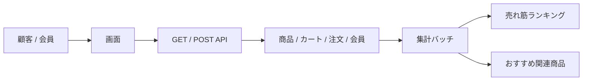

# 画面・API・バッチ一覧（チーム向け）

このドキュメントは、「どの画面があるか」「どんな API があるか」「どんなバッチが走るか」をすぐ把握できるように整理した一覧です。

対象範囲は、このリポジトリ内の EC サイトの主要画面、入力受付 API、そして集計系バッチです。管理画面や受注後の業務処理は、現状のこのアプリでは別システムの責務と見なしています。

---

## 1. まず見るべき全体像

### 1-1. 業務の主な流れ

- 商品探し: 商品一覧 → 商品詳細 → カート追加
- 購入: カート → 注文入力 → 注文確認 → 注文完了
- 会員: 登録 → ログイン → マイページ → 配送先/プロフィール更新
- 自動集計: 起動時 + 毎時 0 分にランキングと関連商品を再計算

### 1-2. 役割別の見方

- 画面担当: ユーザーが実際に触る入口と流れ
- API 担当: フォーム送信・更新・画面表示の入口
- バッチ担当: バックグラウンドで自動集計し、画面に反映する処理

### 1-3. ここを意識すると連携がしやすい

- 会員登録・注文確定・退会などの POST は、主に `member` / `order` / `cart` 系のテーブル更新が発生する想定です。
- 例: 注文確定は `order` 系の注文ヘッダ/明細データの生成と、在庫・会員情報・メール送信の起点として扱うと理解しやすいです。
- 送信フォームの入力値には、通常 `@Valid` や Bean Validation による入力チェックが入る前提で設計し、機能仕様側でエラー文言と例外ハンドリングを整理すると、認識合わせが進みやすくなります。
- バッチ用の内部 API はローカル環境で確認する前提であり、実行前にローカル DB とシードデータが準備済みであることが前提です。

---

## 2. 画面一覧

### 2-1. 購入フローの主要画面

| 区分 | 画面名 | URL | 主な役割 | 認証 | 備考 |
| --- | --- | --- | --- | --- | --- |
| トップ | ホーム | `/` | トップページ、注目商品表示 | 不要 | 入口画面 |
| 商品 | 商品検索 | `/products/search` | キーワード検索、カテゴリ/テイスト/ソート | 不要 | 主要な導線 |
| 商品 | 新着商品一覧 | `/products/new-arrivals` | 新着商品表示 | 不要 | 商品導線の入口 |
| 商品 | カテゴリ別一覧 | `/categories/{category}` | デスク/チェア/収納などの一覧 | 不要 | `/categories/desks` 等 |
| 商品 | 商品詳細 | `/products/{productId}` | 商品情報とレビュー参照 | 不要 | カート追加の入口 |
| 商品 | 商品レビュー | `/products/{productId}/reviews/*` | レビュー投稿・編集 | ログイン必須（投稿時） | 新規/編集画面 |
| カート | カート | `/cart` | 商品一覧、数量変更、削除、クーポン適用 | 要ログインもしくは未ログイン対応 | 注文前の確認画面 |
| 注文 | 注文入力 | `/checkout/input` | 配送先、支払方法、利用規約確認 | 要ログイン | 会員情報を自動入力 |
| 注文 | 注文確認 | `/checkout/confirm` | 最終確認、注文確定 | 要ログイン | 確定ボタンで注文処理 |
| 注文 | 注文完了 | `/checkout/complete` | 注文完了メッセージ表示 | 要ログイン | 注文番号表示 |

### 2-2. 会員・マイページ系の画面

| 区分 | 画面名 | URL | 主な役割 | 認証 | 備考 |
| --- | --- | --- | --- | --- | --- |
| 会員 | ログイン | `/login` | ログイン | 不要 | 現状は SNS 連携なし |
| 会員 | 会員登録 | `/members/register` | 新規会員登録 | 不要 | 確認→完了の流れ |
| 会員 | 会員登録確認 | `/members/register/confirm` | 入力内容確認 | 不要 | 確認画面 |
| 会員 | 会員登録完了 | `/members/register/complete` | 登録完了メッセージ | 不要 | メール送信あり |
| マイページ | マイページ | `/mypage` | 会員向けメニュー | 要ログイン | 入口画面 |
| マイページ | 注文履歴 | `/mypage/orders` | 過去注文一覧 | 要ログイン | 主要機能 |
| マイページ | 注文詳細 | `/mypage/orders/{orderNumber}` | 注文詳細と明細 | 要ログイン | 再注文も可能 |
| マイページ | お気に入り | `/mypage/favorites` | お気に入り商品一覧 | 要ログイン | 重要な個人設定 |
| マイページ | プロフィール | `/mypage/profile` | 会員情報更新 | 要ログイン | 氏名・連絡先等 |
| マイページ | 配送先住所 | `/mypage/addresses` | 配送先一覧・登録・編集 | 要ログイン | 住所の追加/削除 |
| マイページ | 退会 | `/mypage/withdraw` | 会員退会 | 要ログイン | 確認フローあり |

### 2-3. コンテンツ系の画面

| 区分 | 画面名 | URL | 主な役割 |
| --- | --- | --- | --- |
| お知らせ | お知らせ一覧 | `/announcements` | お知らせ表示 |
| コンテンツ | 会社案内 | `/about` | 会社概要・事業紹介 |
| コンテンツ | 利用ガイド | `/guide` | サイト利用ガイド |
| コンテンツ | 利用規約 | `/legal/terms` | 利用規約 |
| コンテンツ | プライバシー | `/legal/privacy` | プライバシーポリシー |
| コンテンツ | 特定商取引法 | `/legal/tokusho` | 表記法定義 |
| 問い合わせ | お問い合わせ | `/contact` | お問い合わせフォーム |

### 2-4. 画面の見方のポイント

- 画面の大半はサーバーサイドの Thymeleaf で生成される MVC 画面です。
- 購入フローと会員フローがメインで、商品・注文・マイページが中心です。
- コンテンツ系は顧客向けの静的情報ページとして整理されています。

---

## 3. API 一覧

### 3-1. 画面の入力・更新系 API

これはフォーム送信や更新処理の入口です。多くの POST はバリデーションやエラー処理が前段で行われ、最終的に対応するデータ更新やメール送信の起点になります。

| 種別 | HTTP | URL | 内容 | 主な更新先イメージ |
| --- | --- | --- | --- | --- |
| 商品 | `POST` | `/products/{productId}/favorite` | お気に入り登録/解除 | 会員お気に入り情報 |
| カート | `POST` | `/cart/items` | カートに商品追加 | カート/商品変種関連 |
| カート | `POST` | `/cart/items/{productVariantId}/update` | カート内数量変更 | カート明細 |
| カート | `POST` | `/cart/items/{productVariantId}/delete` | カート内削除 | カート明細 |
| カート | `POST` | `/cart/apply-coupon` または `/cart/coupon/apply` | クーポン適用 | カート/クーポン適用状態 |
| カート | `POST` | `/cart/remove-coupon` または `/cart/coupon/remove` | クーポン解除 | カート/クーポン適用状態 |
| カート | `POST` | `/cart/clear` | カートを空にする | カート明細 |
| 注文 | `POST` | `/checkout/input` | 注文入力保存・検証 | 注文準備情報 |
| 注文 | `POST` | `/checkout/confirm` | 注文確定 | 注文ヘッダ/明細、支払/配送関連 |
| 注文 | `POST` | `/mypage/orders/{orderNumber}/reorder` | 以前の注文を再注文 | 注文ヘッダ/明細の再作成 |
| 会員 | `POST` | `/members/register/confirm` | 会員登録確認画面へ進む | 入力確認のみ |
| 会員 | `POST` | `/members/register` | 会員登録実行 | 会員情報、メール送信起点 |
| 会員 | `POST` | `/mypage/profile` | プロフィール更新 | 会員情報 |
| 会員 | `POST` | `/mypage/addresses` | 配送先新規登録 | 配送先住所 |
| 会員 | `POST` | `/mypage/addresses/{memberAddressId}` | 配送先更新 | 配送先住所 |
| 会員 | `POST` | `/mypage/addresses/{memberAddressId}/delete` | 配送先削除 | 配送先住所 |
| 会員 | `POST` | `/mypage/withdraw` | 退会処理 | 会員状態/退会情報 |
| 問い合わせ | `POST` | `/contact` | お問い合わせ送信 | お問い合わせ情報 |
| 商品レビュー | `POST` | `/products/{productId}/reviews/edit` | レビュー投稿/更新 | 商品レビュー情報 |

> なお、実際のテーブル名や更新順序は実装・DB設計に依存するため、上記は「更新の主対象イメージ」をコメントとして扱うと理解しやすくなります。
| --- | --- | --- | --- |
| 商品 | `POST` | `/products/{productId}/favorite` | お気に入り登録/解除 |
| カート | `POST` | `/cart/items` | カートに商品追加 |
| カート | `POST` | `/cart/items/{productVariantId}/update` | カート内数量変更 |
| カート | `POST` | `/cart/items/{productVariantId}/delete` | カート内削除 |
| カート | `POST` | `/cart/apply-coupon` または `/cart/coupon/apply` | クーポン適用 |
| カート | `POST` | `/cart/remove-coupon` または `/cart/coupon/remove` | クーポン解除 |
| カート | `POST` | `/cart/clear` | カートを空にする |
| 注文 | `POST` | `/checkout/input` | 注文入力保存・検証 |
| 注文 | `POST` | `/checkout/confirm` | 注文確定 |
| 注文 | `POST` | `/mypage/orders/{orderNumber}/reorder` | 以前の注文を再注文 |
| 会員 | `POST` | `/members/register/confirm` | 会員登録確認画面へ進む |
| 会員 | `POST` | `/members/register` | 会員登録実行 |
| 会員 | `POST` | `/mypage/profile` | プロフィール更新 |
| 会員 | `POST` | `/mypage/addresses` | 配送先新規登録 |
| 会員 | `POST` | `/mypage/addresses/{memberAddressId}` | 配送先更新 |
| 会員 | `POST` | `/mypage/addresses/{memberAddressId}/delete` | 配送先削除 |
| 会員 | `POST` | `/mypage/withdraw` | 退会処理 |
| 問い合わせ | `POST` | `/contact` | お問い合わせ送信 |
| 商品レビュー | `POST` | `/products/{productId}/reviews/edit` | レビュー投稿/更新 |

### 3-2. 画面表示用 GET API

| 種別 | HTTP | URL | 内容 |
| --- | --- | --- | --- |
| 全体 | `GET` | `/` | ホーム |
| 商品 | `GET` | `/products/search` | 商品検索 |
| 商品 | `GET` | `/products/new-arrivals` | 新着商品 |
| 商品 | `GET` | `/categories/desks` | デスク一覧 |
| 商品 | `GET` | `/categories/chairs` | チェア一覧 |
| 商品 | `GET` | `/categories/storages` | 収納一覧 |
| 商品 | `GET` | `/products/{productId}` | 商品詳細 |
| 商品 | `GET` | `/products/recently-viewed` | 最近見た商品 |
| レビュー | `GET` | `/products/{productId}/reviews/new` | レビュー新規作成 |
| レビュー | `GET` | `/products/{productId}/reviews/edit` | レビュー編集 |
| カート | `GET` | `/cart` | カート一覧 |
| 注文 | `GET` | `/checkout/method` | 注文方法選択 |
| 注文 | `GET` | `/checkout/input` | 注文入力 |
| 注文 | `GET` | `/checkout/confirm` | 注文確認 |
| 注文 | `GET` | `/checkout/complete` | 注文完了 |
| 注文 | `GET` | `/checkout/complete/{orderNumber}` | 注文完了詳細 |
| 会員 | `GET` | `/login` | ログイン |
| 会員 | `GET` | `/members/register` | 会員登録 |
| 会員 | `GET` | `/members/register/complete` | 登録完了 |
| マイページ | `GET` | `/mypage` | マイページ |
| マイページ | `GET` | `/mypage/orders` | 注文履歴 |
| マイページ | `GET` | `/mypage/orders/{orderNumber}` | 注文詳細 |
| マイページ | `GET` | `/mypage/favorites` | お気に入り |
| マイページ | `GET` | `/mypage/profile` | プロフィール |
| マイページ | `GET` | `/mypage/addresses` | 配送先一覧 |
| マイページ | `GET` | `/mypage/addresses/new` | 配送先新規登録 |
| マイページ | `GET` | `/mypage/addresses/{memberAddressId}/edit` | 配送先編集 |
| マイページ | `GET` | `/mypage/withdraw` | 退会確認 |
| コンテンツ | `GET` | `/announcements` | お知らせ一覧 |
| コンテンツ | `GET` | `/about` | 会社案内 |
| コンテンツ | `GET` | `/guide` | 利用ガイド |
| コンテンツ | `GET` | `/legal/terms` | 利用規約 |
| コンテンツ | `GET` | `/legal/privacy` | プライバシー |
| コンテンツ | `GET` | `/legal/tokusho` | 特定商取引法 |
| 問い合わせ | `GET` | `/contact` | お問い合わせフォーム |

### 3-3. ローカル開発用のバッチ制御 API

これらは `local` プロファイル時に有効な内部 API です。

| HTTP | URL | 内容 |
| --- | --- | --- |
| `GET` | `/internal/batch/jobs` | ジョブ一覧と最新実行状態を確認 |
| `GET` | `/internal/batch/jobs/{jobName}/executions` | 指定ジョブの直近実行履歴を取得 |
| `POST` | `/internal/batch/jobs/{jobName}/executions` | ジョブを手動起動 |
| `POST` | `/internal/batch/executions/{executionId}/stop` | 実行中ジョブへ停止要求 |

> 本番運用では通常、これらの内部 API を直接使う前提ではなく、アプリ起動時や定期実行で自動処理されます。

---

## 4. バッチ一覧

### 4-1. 現在定義されているバッチ

| バッチ名 | 役割 | トリガー | 実行タイミング | 特徴 |
| --- | --- | --- | --- | --- |
| `popular-ranking` | 売れ筋ランキング再計算 | アプリ起動時、毎時 0 分、手動実行 | `ApplicationReadyEvent` + `@Scheduled(cron = "0 0 * * * *")` | 商品の売れ筋を再算出 |
| `recommended-related` | おすすめ関連商品再計算 | アプリ起動時、毎時 0 分、手動実行 | `ApplicationReadyEvent` + `@Scheduled(cron = "0 0 * * * *")` | 注文履歴から関連商品を再計算 |

### 4-2. バッチの実行ルール

- Spring Batch で実装されている。
- 起動・停止・履歴確認は `BatchExecutionService` で統制される。
- `BatchScheduler` がアプリ起動後と毎時 0 分にバッチを起動する。
- 同一ジョブの二重起動防止や実行状態確認が入っている。
- `local` プロファイルでは内部 API で手動起動や履歴確認が可能。

> 前提: ローカル環境でこの API を確認するには、事前に PostgreSQL / シードデータが準備済みで、アプリが `local` プロファイルで起動している必要があります。初期データがないとジョブ一覧や実行結果の確認がうまく進まないため、動作確認時はシード状態の確認を先にすると迷いません。

---

## 5. チーム向けの見方

### 5-1. 画面側の流れ

- 購入フロー: 商品検索 → 商品詳細 → カート → 注文入力 → 注文確認 → 注文完了
- 会員フロー: 登録 → ログイン → マイページ → 配送先/プロフィール更新 → 退会
- コンテンツ: お知らせ、会社紹介、利用規約、プライバシー

### 5-2. API 側の見方

- 表示系: `GET` で画面や一覧を返す
- 送信系: `POST` でカート、注文、会員登録、問い合わせを処理する
- 運用系: `/internal/batch` でジョブ状態の確認、起動、停止を行う

### 5-3. バッチ側の見方

- 起動時に初回集計を行う
- その後は毎時 0 分に自動再計算する
- 実行履歴が残り、必要に応じて手動実行も可能

