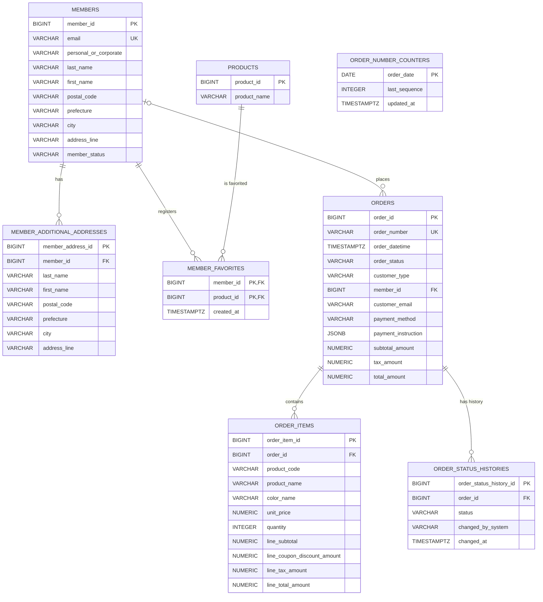
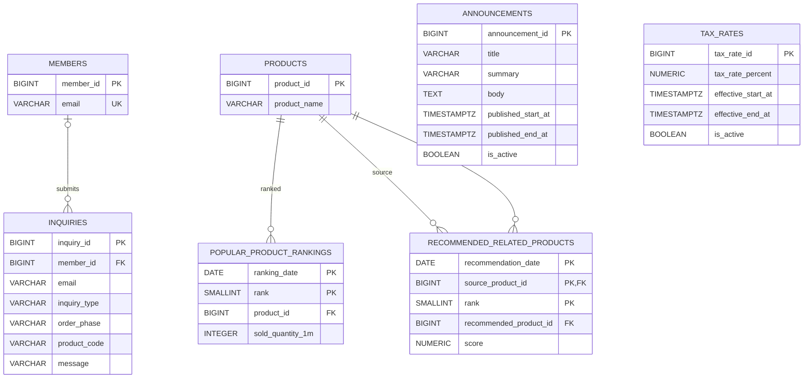
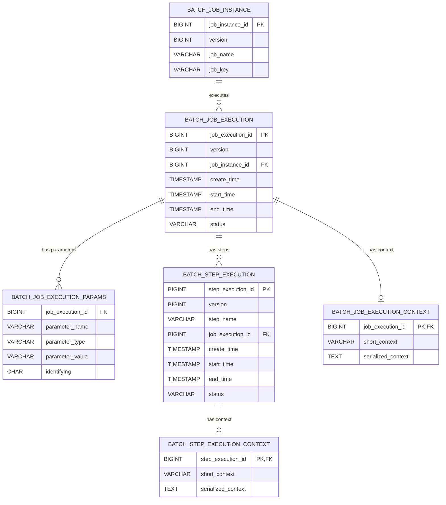

# データベース ER 図

本図は、`sql/schema` 配下のDDLをもとに作成した論理ER図です。テーブルの属性は、主キー（PK）、外部キー（FK）、および業務上の主要項目を中心に記載しています。

- `||` : 1件
- `o{` : 0件以上
- `|{` : 1件以上
- 実線 : DDLで定義された外部キー関係

## 1. 商品・属性マスタ

```mermaid
erDiagram
    PRODUCTS {
        BIGINT product_id PK
        VARCHAR product_name
        VARCHAR category_id
        BOOLEAN assembly_available
        NUMERIC assembly_fee
        BOOLEAN has_variation
        BIGINT variation_group_id
        VARCHAR variation_name
        TIMESTAMPTZ sale_start_at
        TIMESTAMPTZ sale_end_at
    }
    COLORS {
        BIGINT color_id PK
        VARCHAR color_name UK
        CHAR color_code UK
        VARCHAR swatch_type
        INTEGER sort_order
        BOOLEAN is_active
    }
    PRODUCT_VARIANTS {
        BIGINT product_variant_id PK
        BIGINT product_id FK
        VARCHAR product_code UK
        BIGINT color_id FK
        NUMERIC unit_price
        INTEGER stock_quantity
    }
    PRODUCT_DESK_ATTRIBUTES {
        BIGINT product_id PK, FK
        BIGINT top_shape_id FK
        BIGINT taste_id FK
        INTEGER width_mm
        INTEGER depth_mm
        INTEGER height_mm
    }
    PRODUCT_CHAIR_ATTRIBUTES {
        BIGINT product_id PK, FK
        BIGINT function_id FK
        BIGINT material_id FK
        BIGINT taste_id FK
    }
    PRODUCT_STORAGE_ATTRIBUTES {
        BIGINT product_id PK, FK
        BIGINT usage_id FK
        BIGINT taste_id FK
    }
    DESK_TOP_SHAPES {
        BIGINT top_shape_id PK
        VARCHAR display_name UK
    }
    DESK_TASTES {
        BIGINT taste_id PK
        VARCHAR display_name UK
    }
    CHAIR_FUNCTIONS {
        BIGINT function_id PK
        VARCHAR display_name UK
    }
    CHAIR_MATERIALS {
        BIGINT material_id PK
        VARCHAR display_name UK
    }
    CHAIR_TASTES {
        BIGINT taste_id PK
        VARCHAR display_name UK
    }
    STORAGE_USAGES {
        BIGINT usage_id PK
        VARCHAR display_name UK
    }
    STORAGE_TASTES {
        BIGINT taste_id PK
        VARCHAR display_name UK
    }

    PRODUCTS ||--o{ PRODUCT_VARIANTS : "has"
    COLORS ||--o{ PRODUCT_VARIANTS : "colors"
    PRODUCTS ||--o| PRODUCT_DESK_ATTRIBUTES : "desk attributes"
    PRODUCTS ||--o| PRODUCT_CHAIR_ATTRIBUTES : "chair attributes"
    PRODUCTS ||--o| PRODUCT_STORAGE_ATTRIBUTES : "storage attributes"
    DESK_TOP_SHAPES ||--o{ PRODUCT_DESK_ATTRIBUTES : "classifies"
    DESK_TASTES ||--o{ PRODUCT_DESK_ATTRIBUTES : "classifies"
    CHAIR_FUNCTIONS ||--o{ PRODUCT_CHAIR_ATTRIBUTES : "classifies"
    CHAIR_MATERIALS ||--o{ PRODUCT_CHAIR_ATTRIBUTES : "classifies"
    CHAIR_TASTES ||--o{ PRODUCT_CHAIR_ATTRIBUTES : "classifies"
    STORAGE_USAGES ||--o{ PRODUCT_STORAGE_ATTRIBUTES : "classifies"
    STORAGE_TASTES ||--o{ PRODUCT_STORAGE_ATTRIBUTES : "classifies"
```

## 2. 会員・注文

`member_favorites.product_id` の参照先として、商品ドメインの `PRODUCTS` を最小限の外部テーブルとして含めています。

## 3. コンテンツ・集計・推薦

`inquiries.member_id` の参照先として `MEMBERS`、ランキング・推薦の参照先として `PRODUCTS` を最小限の外部テーブルとして含めています。

## 4. Spring Batch（システム）

業務テーブルとは独立した、Spring Batchの実行メタデータ領域です。

## 関係と制約の補足

### 商品

- `product_variants.product_id` は `products.product_id` を参照し、商品削除時はバリアントも削除されます。
- `product_variants.color_id` は `colors.color_id` を参照します。商品とカラーの組み合わせは一意です。
- 商品属性テーブル（`product_desk_attributes`、`product_chair_attributes`、`product_storage_attributes`）は、`product_id` をPK兼FKとする商品ごとの任意の1レコードです。
- デスク、チェア、収納家具のテイストIDは、それぞれ別のマスタを参照します。`taste_id` は3テーブルで共通のID体系ではありません。

### 会員・注文

- `member_favorites` は `members` と `products` の多対多関係を表す中間テーブルで、PKは `(member_id, product_id)` です。
- `orders.member_id` はNULLを許容します。会員注文では必須、ゲスト注文ではNULLという業務制約です。会員削除時はNULLになります。
- `order_items` は `orders` に従属します。`product_code` は注文時点の値を保持する文字列で、DDL上は `product_variants` へのFKではありません。
- `order_number_counters` は注文番号の日次連番管理テーブルで、`orders` へのFKはありません。

### その他

- `inquiries.member_id` は任意の会員参照で、会員削除時はNULLになります。問い合わせの商品コード・注文情報もDDL上のFKではありません。
- `tax_rates` は注文との直接FKを持たず、注文処理時点で有効な税率として利用されます。
- `recommended_related_products` は `products` への2本のFKで自己関連を表します。同一商品を推薦することはCHECK制約で禁止されています。
- Spring Batchの `batch_*` テーブルは、業務テーブルとは独立した実行メタデータ領域です。

## 対象外

- `category_id` は `products` 内のCHECK制約で管理される値（`desk`、`chair`、`storage`）で、カテゴリマスタのテーブルはありません。
- カートはアプリケーションのセッション／Cookie上で管理され、DBテーブルはありません。
- `batch_*_seq` はテーブルではなく、Spring Batch用のシーケンスです。
