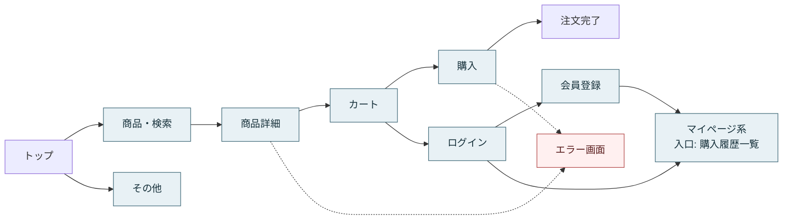
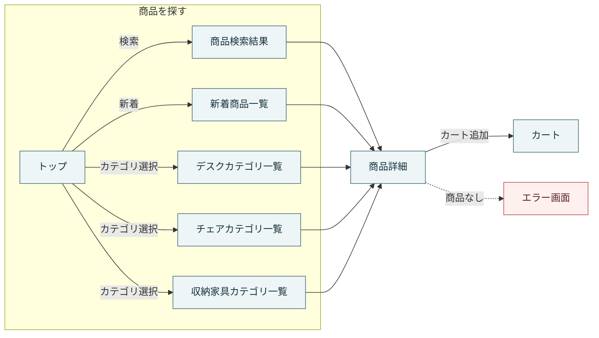
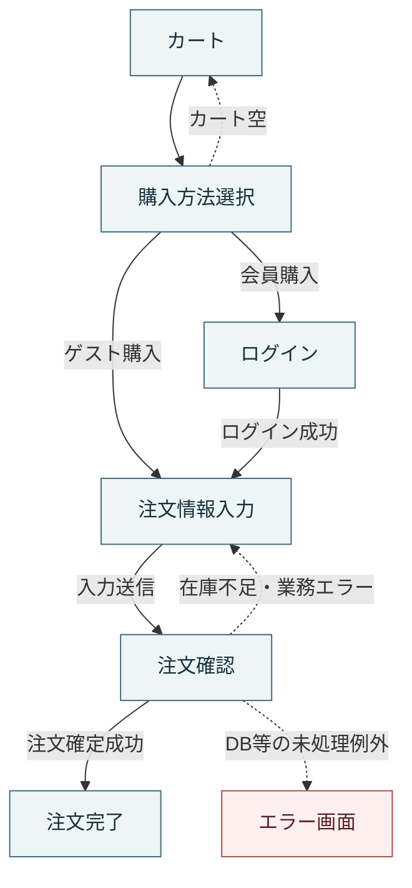
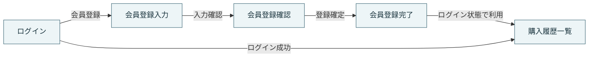
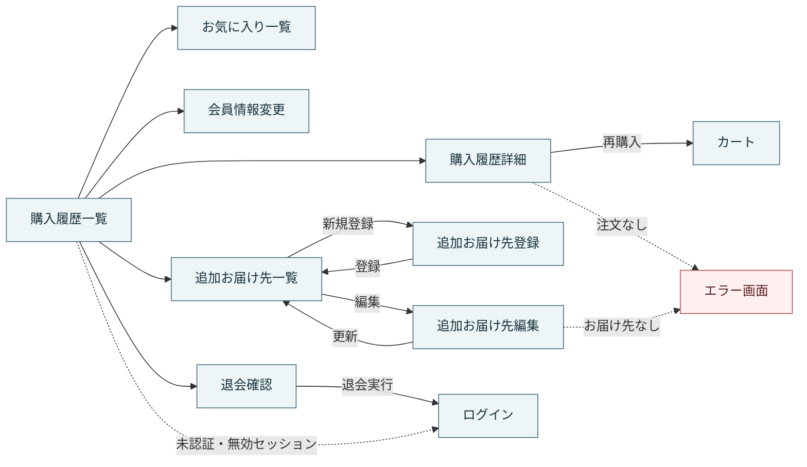
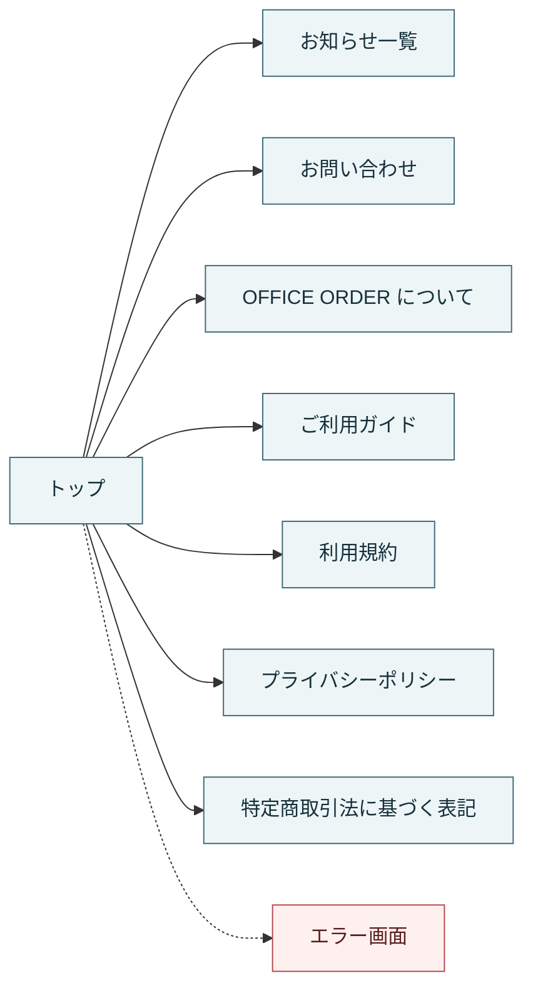

# 画面遷移図

本図は、実装済みの Controller の画面表示・リダイレクトをもとにした主要な画面遷移を示します。画面を伴わない更新処理は、処理ノードから遷移先へ表現しています。

画面名を中心に、利用者がたどる主要な流れを機能単位で整理しています。画面ID、URL、認証条件は [画面一覧](screen-list.md) を参照してください。

通常遷移は実線、入力エラー・認証エラー・対象なしなどの例外遷移は破線で表します。

## ① 全体概要

## ② 商品・検索系画面遷移

検索結果、新着、カテゴリの各一覧から商品詳細へ進み、商品詳細からカートへ進みます。

## ③ 購入系画面遷移

## ④ 会員登録・ログイン系画面遷移

## ⑤ マイページ系画面遷移

マイページ系の入口は購入履歴一覧です。`/mypage` へのアクセスは購入履歴一覧へリダイレクトされます。各機能画面からの操作先を中心に示します。

## ⑥ その他画面

## 補足

- `/mypage/**` は Spring Security により会員ロールが必要です。未認証または無効セッションの場合はログイン画面へ誘導されます。
- 「マイページ」は独立画面ではありません。`/mypage` は購入履歴一覧へリダイレクトされ、画面上のマイページ系入口は購入履歴一覧です。
- 商品詳細のお気に入り操作は、未ログイン時にログイン画面へ誘導されます。ログイン済みの場合は同じ商品詳細を再表示します。
- カート追加、数量変更、削除、全削除は画面を伴わない POST 操作で、操作後はカートへ戻ります。
- ログイン、会員登録確定、会員情報更新、住所の登録・更新・削除、退会実行は画面を伴わない POST 操作です。
- 注文情報入力、注文確認、会員登録入力で入力エラーが発生した場合は、それぞれの入力画面へ戻ります。注文確定時の在庫不足・業務エラーは注文情報入力へ戻ります。
- 注文確定後の DB 保存などで未処理例外が発生した場合は、共通エラー処理を経てエラー画面になります。対象なしの場合もエラー画面になります。
- `GET /products/recently-viewed` は JSON API、`/internal/batch/**` はローカル開発専用の JSON API です。画面ではないため遷移図から意図的に除外しています。
- `/internal/test/errors/500` はローカル開発時のエラー画面確認用で、通常の利用者遷移から意図的に除外しています。