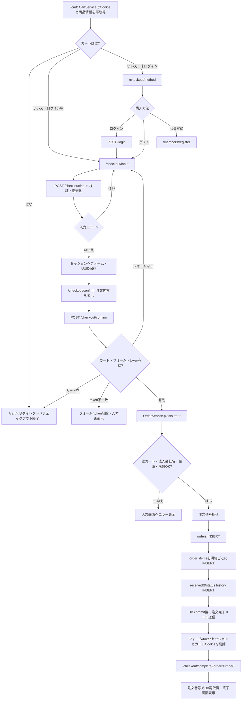

# OFFICE ORDER 注文処理フロー調査

## 調査範囲と前提

注文画面表示から注文完了画面までの実装を、Controller、Service、Repository、MyBatis Mapper／SQL、画面テンプレート、入力モデル、メール送信処理、注文関連テストの順につないで調査した。

READMEでは本リポジトリの対象を商品閲覧、会員登録、カート、注文、お問い合わせまでとしており、受注後の業務処理や管理画面は別システムの責務としている。本書は本リポジトリの注文受付・保存・完了画面表示までを記載する。受注後の出荷、決済の実処理、在庫引当等は、コードで確認できないものを実装済みとして扱わない。

根拠はリポジトリ相対パスにファイル名と行番号を付けている。責務範囲の根拠：[README.md:3-6](../../README.md#L3-L6)。

## 注文処理の全体像

1. `/cart` でCookie内カートを読み、現在販売中の商品情報を取得してカート明細・金額を表示する。
2. カート内の商品がある場合、ログイン中は `/checkout/input`、未ログインは `/checkout/method` へ進む。
3. 購入方法画面ではログイン、会員登録、ゲスト購入の入口を表示する。ゲスト購入は注文情報入力へ進む。ログインフォームは成功後 `/checkout/input` に戻るよう指定する。
4. `/checkout/input` で注文者、配送先、決済方法を表示・入力する。ログイン会員は会員情報を初期値にし、追加お届け先の選択肢を表示する。
5. POST `/checkout/input` でフォームを検証し、正規化したフォームとワンタイムトークンをセッションに保存して `/checkout/confirm` へ進む。
6. 確認画面で注文者・配送先・決済・明細・金額を確認し、POST `/checkout/confirm` にトークンを送信する。
7. Controllerはカート、セッションフォーム、トークンを検査し、ログイン会員なら会員ID、ゲストならnullをServiceに渡す。
8. `OrderService.placeOrder` は入力・在庫を再確認し、注文番号、決済案内、注文ヘッダ・明細・初期ステータス履歴を作成する。注文処理は`@Transactional`である。
9. トランザクションコミット後に注文完了メール送信を実行する。Service成功後、Controllerは注文フォーム・トークンのセッション属性とカートCookieを削除して、注文番号付き完了URLへリダイレクトする。
10. 完了画面GETは注文番号で注文情報を再取得して表示する。コンビニ決済の場合、保存済み支払案内も表示する。

主要な入口・呼び出し順：

`CartController` → `CartService.getCart` → `CartRepository.findProductSnapshotsByVariantIds` → `CartMapper.selectCartProductSnapshots` → `CartController` → `OrderService.placeOrder` → `OrderRepository` → `OrderMapper` → `OrderMapper.xml` → DB。完了画面では`CartController` → `OrderService.findOrderCompleteView` → `OrderRepository.findOrderCompleteByOrderNumber` → `OrderMapper.selectOrderCompleteByOrderNumber` → DB。

根拠：[CartController.java:246-256](../../src/main/java/jp/co/skig/officeorder/web/CartController.java#L246-L256)、[CartController.java:268-288](../../src/main/java/jp/co/skig/officeorder/web/CartController.java#L268-L288)、[CartController.java:303-328](../../src/main/java/jp/co/skig/officeorder/web/CartController.java#L303-L328)、[CartController.java:377-440](../../src/main/java/jp/co/skig/officeorder/web/CartController.java#L377-L440)、[OrderService.java:148-240](../../src/main/java/jp/co/skig/officeorder/service/order/OrderService.java#L148-L240)、[OrderRepository.java:83-118](../../src/main/java/jp/co/skig/officeorder/repository/OrderRepository.java#L83-L118)、[OrderMapper.java:28-53](../../src/main/java/jp/co/skig/officeorder/mapper/OrderMapper.java#L28-L53)。

## 画面遷移の順番

| 起点／条件 | 遷移先 | 実装上の内容 |
|---|---|---|
| カートに商品がある・ログイン中 | `/checkout/input` | カート画面の購入手続きリンクはログイン状態で遷移先を分ける。 |
| カートに商品がある・未ログイン | `/checkout/method` | 購入方法選択画面を表示する。 |
| 購入方法選択・ログイン | POST `/login` → 成功後 `/checkout/input` | 画面フォームの`redirectPath`が`/checkout/input`。認証成功ハンドラが戻り先を処理する。 |
| 購入方法選択・会員登録 | `/members/register` | 会員登録画面へのリンク。登録後に注文へ戻す動作は当該画面内では指定されていない。 |
| 購入方法選択・ゲスト | `/checkout/input` | 会員登録せず注文情報入力へ進む。 |
| 注文情報入力 POST成功 | `/checkout/confirm` | セッションへフォームとトークンを保存した後にリダイレクト。 |
| 注文確認 POST成功 | `/checkout/complete/{orderNumber}` | 注文保存後にセッションフォーム、確認トークン、カートCookieを削除して遷移。 |
| `/checkout/complete`（注文番号なし） | `/checkout/input` | 入力画面へのフォールバック。 |
| `/checkout/complete/{orderNumber}`（該当注文なし） | 404 | 注文番号で見つからない場合はNot Found。 |

根拠：[cart.html:143-146](../../src/main/resources/templates/pages/cart.html#L143-L146)、[checkout-method.html:20-58](../../src/main/resources/templates/pages/checkout-method.html#L20-L58)、[SecurityConfig.java:92-136](../../src/main/java/jp/co/skig/officeorder/config/SecurityConfig.java#L92-L136)、[CartController.java:246-256](../../src/main/java/jp/co/skig/officeorder/web/CartController.java#L246-L256)、[CartController.java:325-328](../../src/main/java/jp/co/skig/officeorder/web/CartController.java#L325-L328)、[CartController.java:402-440](../../src/main/java/jp/co/skig/officeorder/web/CartController.java#L402-L440)。

## 各画面での処理内容

### カート画面 `/cart`

- Cookie名は`office_order_cart`。Cookieには商品バリアントID、数量、組立指定を明細ごとに保存する。読込時に形式・正のID・数量1～99を検査し、最大100明細を処理する。
- `CartService.getCart`はCookie明細の商品スナップショットを取得する。スナップショットSQLは販売期間内の商品だけを返す。該当スナップショットがない明細は画面明細から除き、Cookie内容が正規化結果と異なる場合はCookieを保存し直す。
- 商品小計・組立費を計算し、税額は整数単位で端数切捨て。税込小計5,000円以上なら送料0円、未満なら800円。現在有効な税率のDB検索結果がない場合、CartRepositoryは10%を返す。
- クーポンは任意。カート画面で入力されたコードはセッションに置かれ、カート取得時にログイン会員、クーポン有効性、期間、最低購入額、会員別利用回数を検査して割引計算する。未ログインまたは検証エラーならコードをセッションから除去し、カート画面にエラーを出す。
- Cookie内に保存される組立指定は商品ごとの可否で正規化される。追加・更新時の数量上限は1明細99、追加時の明細上限は100。

根拠：[CartCookieStore.java:24-90](../../src/main/java/jp/co/skig/officeorder/repository/CartCookieStore.java#L24-L90)、[CartCookieStore.java:94-155](../../src/main/java/jp/co/skig/officeorder/repository/CartCookieStore.java#L94-L155)、[CartService.java:94-180](../../src/main/java/jp/co/skig/officeorder/service/cart/CartService.java#L94-L180)、[CartMapper.xml:21-50](../../src/main/resources/mappers/CartMapper.xml#L21-L50)、[CartRepository.java:38-60](../../src/main/java/jp/co/skig/officeorder/repository/CartRepository.java#L38-L60)、[CouponServiceImpl.java:25-74](../../src/main/java/jp/co/skig/officeorder/service/coupon/CouponServiceImpl.java#L25-L74)、[CartController.java:198-217](../../src/main/java/jp/co/skig/officeorder/web/CartController.java#L198-L217)。

### 購入方法選択 `/checkout/method`

- GET時、カートを再取得し、空なら`/cart`へ戻す。
- 画面はログインフォーム、会員登録リンク、ゲスト購入リンクを表示する。
- ログインフォームの戻り先は`/checkout/input`。購入方法画面に表示する記憶済みメールアドレスはLoginEmailCookieServiceから取得する。
- ログイン会員にはカート画面から注文情報入力への直接リンクもある。

根拠：[CartController.java:246-256](../../src/main/java/jp/co/skig/officeorder/web/CartController.java#L246-L256)、[CartController.java:475-486](../../src/main/java/jp/co/skig/officeorder/web/CartController.java#L475-L486)、[checkout-method.html:20-58](../../src/main/resources/templates/pages/checkout-method.html#L20-L58)、[cart.html:143-146](../../src/main/resources/templates/pages/cart.html#L143-L146)。

### 注文情報入力 `/checkout/input`

- GET時にカートを取得し、空なら`/cart`へ戻す。既にセッションにフォームがあれば再利用する。フォームがなければログイン会員の有効な基本情報・既定お届け先情報を初期値にする。ゲストは空の初期フォームになる。
- 会員注文の場合、追加お届け先一覧の先頭ページを選択肢として表示する。JavaScriptは選択されたoptionのdata属性から郵便番号・住所・階数・エレベーター・電話・FAXを入力欄へ転記する。
- 入力項目は個人／法人、氏名・カナ、会社・部署、メール、日中電話・FAX、郵便番号、都道府県、市区町村、住所行、階数、エレベーター有無、決済手段。決済手段は銀行振込・代金引換・コンビニ決済。
- `CheckoutInputForm`の検証では、区分、氏名・カナ、メール、電話、郵便番号、住所、階数、エレベーター、決済手段を必須とする。法人は別途会社名必須。文字数・形式制限はフォームのBean ValidationおよびValidationPatternsに定義されている。
- POST成功時、入力値をtrim・空欄null化してセッションへ保存し、UUIDトークンもセッションへ保存する。
- 追加お届け先の`selectedAdditionalAddressId`はフォーム値として保持できるが、この注文処理でIDから住所をサーバー再取得する処理は確認できない。注文にはフォームの配送先項目が使われる。

根拠：[CartController.java:268-288](../../src/main/java/jp/co/skig/officeorder/web/CartController.java#L268-L288)、[OrderService.java:103-136](../../src/main/java/jp/co/skig/officeorder/service/order/OrderService.java#L103-L136)、[OrderMapper.xml:101-122](../../src/main/resources/mappers/OrderMapper.xml#L101-L122)、[CartController.java:303-328](../../src/main/java/jp/co/skig/officeorder/web/CartController.java#L303-L328)、[CartController.java:467-474](../../src/main/java/jp/co/skig/officeorder/web/CartController.java#L467-L474)、[checkout-input.html:23-183](../../src/main/resources/templates/pages/checkout-input.html#L23-L183)、[CheckoutInputForm.java:20-120](../../src/main/java/jp/co/skig/officeorder/model/order/CheckoutInputForm.java#L20-L120)、[ValidationPatterns.java:11-33](../../src/main/java/jp/co/skig/officeorder/common/validation/ValidationPatterns.java#L11-L33)、[checkout-input.js:25-87](../../src/main/resources/static/js/modules/checkout-input.js#L25-L87)。

### 注文確認 `/checkout/confirm`

- GET時にカートを再取得。空なら注文フォーム・トークンをセッションから削除して`/cart`へ戻す。
- 注文フォームがセッションになければ`/checkout/input`へ戻す。トークンがなければGET時に新しいUUIDを生成してセッションに設定する。
- 注文者情報、配送先、決済方法、商品名・色・単価・組立費・数量・小計、商品小計・組立費・送料・税・クーポン割引・合計を確認画面に表示する。
- 確定ボタンはセッション上の確認トークンをhidden項目でPOSTする。

根拠：[CartController.java:340-365](../../src/main/java/jp/co/skig/officeorder/web/CartController.java#L340-L365)、[checkout-confirm.html:20-108](../../src/main/resources/templates/pages/checkout-confirm.html#L20-L108)。

### 注文完了 `/checkout/complete/{orderNumber}`

- 完了GETは注文番号でDBを引き、注文者名・メール・決済方法・配送先・階数・エレベーター・合計を表示する。
- コンビニ決済の場合、注文に保存された支払番号と支払期限を表示する。
- 注文番号に該当する注文がなければ404。注文番号なしの`/checkout/complete`は入力画面へリダイレクトする。
- **アクセス制御上の重要事項:** 認証や注文者本人との照合は確認できず、有効な注文番号を知るアクセス者に注文情報を表示する実装である。これはソースで確認できる動作であり、第三者が実際に有効な注文番号を取得できるかは未確認。取得可能性を実装事実として断定しない。詳しい根拠は「追加調査」のアクセス制御を参照。
- 注文完了画面のテンプレートには「注文完了メールを送信しました」と表示される。メール送信処理の実行タイミングと再試行は「注文完了後に行われる処理」を参照。

根拠：[SecurityConfig.java:75-89](../../src/main/java/jp/co/skig/officeorder/config/SecurityConfig.java#L75-L89)、[CartController.java:422-440](../../src/main/java/jp/co/skig/officeorder/web/CartController.java#L422-L440)、[OrderService.java:307-314](../../src/main/java/jp/co/skig/officeorder/service/order/OrderService.java#L307-L314)、[OrderRepository.java:129-166](../../src/main/java/jp/co/skig/officeorder/repository/OrderRepository.java#L129-L166)、[OrderMapper.xml:277-302](../../src/main/resources/mappers/OrderMapper.xml#L277-L302)、[checkout-complete.html:20-64](../../src/main/resources/templates/pages/checkout-complete.html#L20-L64)。

## ControllerからSQLまでの呼び出し順序

### カートの表示・入力データ取得

1. `CartController.checkoutMethod`、`checkoutInput`、`checkoutInputSubmit`、`checkoutConfirm`、`placeOrder`の各処理で`CartService.getCart(request, response)`を呼ぶ。
2. `CartService.getCart`は`CartCookieStore.load`でCookie明細を読み、`CartRepository.findProductSnapshotsByVariantIds`を呼ぶ。
3. Repositoryは`CartMapper.selectCartProductSnapshots`を呼び、`product_variants`、`products`、`colors`を結合して価格・在庫・商品・組立情報を取得する。販売期間外商品はSQL結果から外れる。
4. CartServiceはカート明細、商品小計、組立費、税、送料、クーポン割引を組み立て、画面に渡す`CartView`を返す。

根拠：[CartController.java:268-365](../../src/main/java/jp/co/skig/officeorder/web/CartController.java#L268-L365)、[CartController.java:377-408](../../src/main/java/jp/co/skig/officeorder/web/CartController.java#L377-L408)、[CartService.java:94-195](../../src/main/java/jp/co/skig/officeorder/service/cart/CartService.java#L94-L195)、[CartRepository.java:38-60](../../src/main/java/jp/co/skig/officeorder/repository/CartRepository.java#L38-L60)、[CartMapper.xml:21-50](../../src/main/resources/mappers/CartMapper.xml#L21-L50)。

### 注文確定

1. POST `/checkout/confirm`の`CartController.placeOrder`がカート・セッションのフォーム・トークンを検査する。
2. `MemberSessionService.currentMember`から会員IDを取得する。会員なしの場合は`null`を渡す。
3. `OrderService.placeOrder`（`@Transactional`）がフォームを正規化し、空カート、法人会社名、在庫、階数を検査する。
4. Serviceは現在有効な税率を`OrderRepository.findCurrentTaxRatePercent`から取得し、決済案内JSONと注文番号を準備する。
5. 注文番号採番は`OrderRepository.nextOrderSequence` → `OrderMapper.nextOrderSequence` → `OrderMapper.xml`の日付単位counter INSERT／ON CONFLICT UPDATE／RETURNING。
6. `OrderRepository.insertOrder` → `OrderMapper.insertOrder` → `OrderMapper.xml`の注文ヘッダINSERTで注文IDを取得する。
7. カート明細ごとに`OrderRepository.insertOrderItem` → `OrderMapper.insertOrderItem` → SQL INSERTを行う。
8. `OrderRepository.insertOrderStatusHistory` → `OrderMapper.insertOrderStatusHistory` → SQL INSERTで初期履歴を追加する。
9. Serviceはトランザクションコミット後にメールを送るTransactionSynchronizationを登録する。
10. Service成功後、Controllerが注文フォーム・トークンとカートCookieを削除し、注文番号付き完了画面へリダイレクトする。

根拠：[CartController.java:377-408](../../src/main/java/jp/co/skig/officeorder/web/CartController.java#L377-L408)、[OrderService.java:148-171](../../src/main/java/jp/co/skig/officeorder/service/order/OrderService.java#L148-L171)、[OrderService.java:193-240](../../src/main/java/jp/co/skig/officeorder/service/order/OrderService.java#L193-L240)、[OrderService.java:279-300](../../src/main/java/jp/co/skig/officeorder/service/order/OrderService.java#L279-L300)、[OrderRepository.java:83-118](../../src/main/java/jp/co/skig/officeorder/repository/OrderRepository.java#L83-L118)、[OrderMapper.java:28-53](../../src/main/java/jp/co/skig/officeorder/mapper/OrderMapper.java#L28-L53)、[OrderMapper.xml:257-275](../../src/main/resources/mappers/OrderMapper.xml#L257-L275)、[OrderMapper.xml:124-255](../../src/main/resources/mappers/OrderMapper.xml#L124-L255)。

## 条件分岐とエラー処理

| 条件 | 実装される処理・遷移 | 根拠 |
|---|---|---|
| ログイン状態 | ログイン中はカートから注文入力へ直接進み、会員情報で初期入力・追加お届け先候補を表示する。未ログインは購入方法選択を経由し、ゲストとして注文可能。注文の`customer_type`は会員IDの有無で`member`／`guest`に分ける。 | [cart.html:143-146](../../src/main/resources/templates/pages/cart.html#L143-L146)、[CartController.java:467-474](../../src/main/java/jp/co/skig/officeorder/web/CartController.java#L467-L474)、[OrderService.java:163-165](../../src/main/java/jp/co/skig/officeorder/service/order/OrderService.java#L163-L165) |
| カートが空 | 購入方法・入力・確認画面表示では`/cart`へ戻る。確認画面GETまたは注文確定POSTで空なら注文フォームとトークンも消す。Serviceにも空カート拒否がある。 | [CartController.java:246-252](../../src/main/java/jp/co/skig/officeorder/web/CartController.java#L246-L252)、[CartController.java:268-276](../../src/main/java/jp/co/skig/officeorder/web/CartController.java#L268-L276)、[CartController.java:340-349](../../src/main/java/jp/co/skig/officeorder/web/CartController.java#L340-L349)、[CartController.java:377-386](../../src/main/java/jp/co/skig/officeorder/web/CartController.java#L377-L386)、[OrderService.java:148-154](../../src/main/java/jp/co/skig/officeorder/service/order/OrderService.java#L148-L154) |
| 注文フォームがセッションにない | 確認GETは入力画面へ戻る。確定POSTは「入力内容を再確認してください」をフラッシュ属性に設定して入力画面へ戻る。 | [CartController.java:350-353](../../src/main/java/jp/co/skig/officeorder/web/CartController.java#L350-L353)、[CartController.java:388-391](../../src/main/java/jp/co/skig/officeorder/web/CartController.java#L388-L391)、[messages.properties:71](../../src/main/resources/messages.properties#L71) |
| 確認トークンなし／不一致 | 確定POSTはトークン不一致としてフォームとトークンを削除し、「注文の再送信を検出しました。入力内容を再確認してください」を表示して入力画面へ戻る。 | [CartController.java:393-399](../../src/main/java/jp/co/skig/officeorder/web/CartController.java#L393-L399)、[CartController.java:460-465](../../src/main/java/jp/co/skig/officeorder/web/CartController.java#L460-L465)、[messages.properties:72](../../src/main/resources/messages.properties#L72) |
| 入力値不正 | Bean Validationエラーまたは法人会社名不足なら注文入力画面を再表示。項目ごとのメッセージをフォーム上に表示する。 | [CartController.java:303-324](../../src/main/java/jp/co/skig/officeorder/web/CartController.java#L303-L324)、[CartController.java:482-486](../../src/main/java/jp/co/skig/officeorder/web/CartController.java#L482-L486)、[checkout-input.html:20-23](../../src/main/resources/templates/pages/checkout-input.html#L20-L23)、[CheckoutInputForm.java:22-92](../../src/main/java/jp/co/skig/officeorder/model/order/CheckoutInputForm.java#L22-L92) |
| 注文確定時に在庫切れまたは注文数量超過 | Serviceが`IllegalArgumentException`（在庫不足メッセージ）を投げ、Controllerがメッセージをフラッシュ属性に入れて入力画面へ戻る。 | [OrderService.java:416-424](../../src/main/java/jp/co/skig/officeorder/service/order/OrderService.java#L416-L424)、[CartController.java:410-413](../../src/main/java/jp/co/skig/officeorder/web/CartController.java#L410-L413)、[messages.properties:81](../../src/main/resources/messages.properties#L81) |
| 階数が空／Integerの範囲外 | Serviceの階数変換が例外を投げ、Controllerの`IllegalArgumentException`処理で入力画面へ戻る。 | [OrderService.java:435-443](../../src/main/java/jp/co/skig/officeorder/service/order/OrderService.java#L435-L443)、[CartController.java:410-413](../../src/main/java/jp/co/skig/officeorder/web/CartController.java#L410-L413) |
| 決済方法 | 入力値は3種類に制限。コンビニ決済だけ6桁の支払番号と、アプリ日付の3日後を期限とする支払案内JSONを生成する。他2種は支払案内を`null`とする。 | [CheckoutInputForm.java:90-92](../../src/main/java/jp/co/skig/officeorder/model/order/CheckoutInputForm.java#L90-L92)、[ValidationPatterns.java:23-25](../../src/main/java/jp/co/skig/officeorder/common/validation/ValidationPatterns.java#L23-L25)、[OrderService.java:380-398](../../src/main/java/jp/co/skig/officeorder/service/order/OrderService.java#L380-L398) |
| 決済案内JSON作成失敗 | Serviceは`IllegalStateException`を投げる。Controllerが捕捉するのは`IllegalArgumentException`のみのため、注文入力画面への業務エラー遷移はこのcatchでは行われない。 | [OrderService.java:380-398](../../src/main/java/jp/co/skig/officeorder/service/order/OrderService.java#L380-L398)、[CartController.java:410-413](../../src/main/java/jp/co/skig/officeorder/web/CartController.java#L410-L413) |
| 注文番号が日次上限超過 | 採番結果が999,999を超えるとServiceは`IllegalStateException`を投げる。利用者向け注文画面メッセージの処理はこのコードでは確認できない。 | [OrderService.java:51-55](../../src/main/java/jp/co/skig/officeorder/service/order/OrderService.java#L51-L55)、[OrderService.java:360-371](../../src/main/java/jp/co/skig/officeorder/service/order/OrderService.java#L360-L371) |
| 注文ヘッダINSERTがIDを返さない | Repositoryが`IllegalStateException`を投げる。 | [OrderRepository.java:83-89](../../src/main/java/jp/co/skig/officeorder/repository/OrderRepository.java#L83-L89) |
| 完了URLの注文番号がDBにない | 完了GETは404。 | [CartController.java:434-440](../../src/main/java/jp/co/skig/officeorder/web/CartController.java#L434-L440)、[OrderRepository.java:129-142](../../src/main/java/jp/co/skig/officeorder/repository/OrderRepository.java#L129-L142) |

## セッションやCookieの使用と削除タイミング

| 値 | 保存・利用 | 削除／更新タイミング | 根拠 |
|---|---|---|---|
| `office_order_cart` Cookie | カート明細（`variantId:quantity:assembly`形式）を保持。CookieはHttpOnly、Path `/`、MaxAge `-1`（ブラウザーセッションCookie）。 | 明細が空または保存対象がない場合、`MaxAge=0`で削除。注文確定成功時、Controllerから`CartService.clear`を呼んで削除。 | [CartCookieStore.java:24-28](../../src/main/java/jp/co/skig/officeorder/repository/CartCookieStore.java#L24-L28)、[CartCookieStore.java:94-155](../../src/main/java/jp/co/skig/officeorder/repository/CartCookieStore.java#L94-L155)、[CartController.java:402-405](../../src/main/java/jp/co/skig/officeorder/web/CartController.java#L402-L405) |
| `checkout_input_form` | 入力POST成功時に正規化したフォームを保存し、確認GET・確定POSTで利用。 | 注文確定成功、確認GETでカートが空、確定POSTでカートが空、トークン不一致のとき削除。注文確定時に`IllegalArgumentException`が起きたときはこのキーを削除するコードはなく、フォームを保持したまま入力へ戻る。 | [CartController.java:51-53](../../src/main/java/jp/co/skig/officeorder/web/CartController.java#L51-L53)、[CartController.java:325-326](../../src/main/java/jp/co/skig/officeorder/web/CartController.java#L325-L326)、[CartController.java:347-399](../../src/main/java/jp/co/skig/officeorder/web/CartController.java#L347-L399)、[CartController.java:460-465](../../src/main/java/jp/co/skig/officeorder/web/CartController.java#L460-L465) |
| `checkout_confirm_token` | 入力POSTでUUIDを保存。確認画面GETで欠落していた場合も生成・保存し、確認POSTで比較する。 | 注文成功、確認GET／確定POSTでカートが空、トークン不一致時に削除。 | [CartController.java:325-326](../../src/main/java/jp/co/skig/officeorder/web/CartController.java#L325-L326)、[CartController.java:354-358](../../src/main/java/jp/co/skig/officeorder/web/CartController.java#L354-L358)、[CartController.java:385-399](../../src/main/java/jp/co/skig/officeorder/web/CartController.java#L385-L399)、[CartController.java:460-465](../../src/main/java/jp/co/skig/officeorder/web/CartController.java#L460-L465) |
| `appliedCouponCode` | クーポン適用時にセッションへ保存。カート取得時に検証し、明示解除時に削除。未ログイン・検証失敗時にも削除。 | 注文成功時の`clearCheckoutSession`は注文フォーム・トークンのみを削除し、`appliedCouponCode`を削除しない。したがって、成功経路でこの値を消す処理は確認できない。 | [CartController.java:198-217](../../src/main/java/jp/co/skig/officeorder/web/CartController.java#L198-L217)、[CartService.java:158-180](../../src/main/java/jp/co/skig/officeorder/service/cart/CartService.java#L158-L180)、[CartController.java:402-405](../../src/main/java/jp/co/skig/officeorder/web/CartController.java#L402-L405)、[CartController.java:460-465](../../src/main/java/jp/co/skig/officeorder/web/CartController.java#L460-L465) |
| ログインメール記憶Cookie | 購入方法画面のログインフォームへ記憶済みメールアドレスを初期表示する。 | この注文Controller経路でのCookie削除は未確認。認証・Cookieサービスの個別動作はログイン機能側の処理。 | [CartController.java:475-486](../../src/main/java/jp/co/skig/officeorder/web/CartController.java#L475-L486)、[checkout-method.html:20-38](../../src/main/resources/templates/pages/checkout-method.html#L20-L38) |

## データベースへの保存内容

注文のINSERTはOrderServiceのトランザクション内で行われる。

### 注文番号counter

- 注文日ごとのcounterに初回1をINSERTし、既存日付なら`last_sequence + 1`に更新して値を返す。
- 注文番号形式は`ORD`＋`yyyyMMdd`＋`-`＋6桁連番。日次連番が999,999を超えると例外。
- SQLの根拠：[OrderMapper.xml:257-275](../../src/main/resources/mappers/OrderMapper.xml#L257-L275)。Serviceの整形・上限：[OrderService.java:360-371](../../src/main/java/jp/co/skig/officeorder/service/order/OrderService.java#L360-L371)。

### 注文ヘッダ `orders`

保存項目は注文番号・日時・状態、顧客種別、会員ID、個人／法人、注文者名・カナ・会社・部署・メール・電話、配送先住所・階数・エレベーター、決済方法・支払案内、配送方法、送料、組立費合計、商品小計、税額、合計、クーポン欄、領収書フラグ、備考、作成・更新日時。

- `order_status`はSQLで`received`を固定値として保存。
- `customer_type`と`member_id`は会員IDの有無で`member`＋ID、または`guest`＋null。
- `shipping_method`はカート内に組立指定があれば`assembly`、なければ`normal`。
- `receipt_issued`は`FALSE`、`note`は`NULL`。
- `total_amount`にはCartServiceが算出したクーポン適用後の`totalAmount`を渡す。`subtotal_amount`には`productSubtotal`、`tax_amount`にはCartServiceの`taxAmount`を渡す。割引後合計と各内訳の関連について、実装事実を超える妥当性評価は行わない。
- Mapper SQLにはクーポンコード・割引額の列とMapキー参照があるが、OrderServiceは`orderParams`にそのキーを設定しない。注文確定時にそれらの値をServiceから渡していないことは確認できる一方、DBに実際に格納される値は注文経路のDBテストで確認できず未確認。詳細は「追加調査」のクーポン割引と注文金額を参照。

根拠：[OrderService.java:163-204](../../src/main/java/jp/co/skig/officeorder/service/order/OrderService.java#L163-L204)、[OrderMapper.xml:124-207](../../src/main/resources/mappers/OrderMapper.xml#L124-L207)、[orders.sql:1-50](../../sql/schema/orders.sql#L1-L50)。

### 注文明細 `order_items`

カート各明細につき、注文ID、商品コード・名称・色、単価、数量、明細小計、明細税額、明細合計、組立可否、組立費、作成・更新日時を保存する。明細小計は`CartLineView.lineSubtotalBeforeTax`、明細税額は小計×税率÷100を整数単位で`RoundingMode.DOWN`、明細合計は小計＋明細税額。組立費欄は組立可能かつ組立指定ありの場合に1点あたり費用、それ以外は0。

根拠：[OrderService.java:205-229](../../src/main/java/jp/co/skig/officeorder/service/order/OrderService.java#L205-L229)、[OrderMapper.xml:209-240](../../src/main/resources/mappers/OrderMapper.xml#L209-L240)、[orders.sql:62-81](../../sql/schema/orders.sql#L62-L81)。

### 注文ステータス履歴 `order_status_histories`

注文作成直後にステータス`received`、変更元`office_order_web`を保存する。以降のステータス履歴追加・更新は注文確定処理では確認できない。

根拠：[OrderService.java:236-240](../../src/main/java/jp/co/skig/officeorder/service/order/OrderService.java#L236-L240)、[OrderMapper.xml:242-255](../../src/main/resources/mappers/OrderMapper.xml#L242-L255)、[orders.sql:83-93](../../sql/schema/orders.sql#L83-L93)。

## 注文完了後に行われる処理

### 実装されている処理

- OrderServiceは注文完了メール送信をDBトランザクションのafterCommitコールバックに登録する。同期が有効でない場合は`IllegalStateException`を投げる。
- コミット後、`NotificationMailService.sendOrderCompleteMail`が注文者メールアドレス宛にメールを送る。送信失敗時は設定済みの遅延再試行を行い、上限到達後にエラーログを記録する。宛先がない場合は送信をスキップする。
- OrderServiceからControllerへ注文番号を返した後、Controllerは注文フォーム・トークンのセッション値とカートCookieを削除し、完了URLへリダイレクトする。
- 完了GETはDBから注文情報を取得して画面表示する。コンビニ決済には支払番号・期限を表示する。

根拠：[OrderService.java:279-300](../../src/main/java/jp/co/skig/officeorder/service/order/OrderService.java#L279-L300)、[NotificationMailService.java:112-184](../../src/main/java/jp/co/skig/officeorder/service/mail/NotificationMailService.java#L112-L184)、[CartController.java:402-440](../../src/main/java/jp/co/skig/officeorder/web/CartController.java#L402-L440)、[checkout-complete.html:20-64](../../src/main/resources/templates/pages/checkout-complete.html#L20-L64)。

### 注文確定経路でコード上確認できない処理

- 注文確定経路に商品在庫を減算するSQL・Service呼び出しは確認できない。確定直前に行うのは在庫数の再検査。
- 銀行振込・代引・コンビニ決済の外部決済実行、決済結果受信・照合は注文確定経路で確認できない。コンビニ決済について確認できるのは支払番号と期限を含む案内情報の生成・保存・表示。
- 注文確定時にクーポン利用回数を記録する呼び出しは確認できない。カートでの適用と注文ヘッダ上のコード・割引額の保存可否は「追加調査」のクーポン割引と注文金額に記載する。

根拠：[OrderService.java:148-240](../../src/main/java/jp/co/skig/officeorder/service/order/OrderService.java#L148-L240)、[OrderMapper.xml:124-255](../../src/main/resources/mappers/OrderMapper.xml#L124-L255)、[CouponServiceImpl.java:66-74](../../src/main/java/jp/co/skig/officeorder/service/coupon/CouponServiceImpl.java#L66-L74)。

### READMEで別システムの責務とされている処理

- 受注後の出荷、受注作業、後続ステータス更新、キャンセル、管理画面処理は、本リポジトリの実装済み機能として扱わない。READMEでは受注後の業務処理と管理画面を別システムの責務としている。個別処理の有無について本リポジトリ内で確認できない点は、上記の責務範囲に基づき区別する。

根拠：[README.md:3-6](../../README.md#L3-L6)。

## Mermaid形式のフロー図

フロー図の根拠：[CartController.java:246-440](../../src/main/java/jp/co/skig/officeorder/web/CartController.java#L246-L440)、[OrderService.java:148-300](../../src/main/java/jp/co/skig/officeorder/service/order/OrderService.java#L148-L300)、[OrderMapper.xml:124-302](../../src/main/resources/mappers/OrderMapper.xml#L124-L302)。

## 関連テスト

- 空カート注文が例外になるテスト：[OrderServiceTest.java:77-87](../../src/test/java/jp/co/skig/officeorder/service/order/OrderServiceTest.java#L77-L87)。
- コンビニ決済の支払案内と注文完了メールコールバックを確認するテスト：[OrderServiceTest.java:90-120](../../src/test/java/jp/co/skig/officeorder/service/order/OrderServiceTest.java#L90-L120)。

## 追加調査（注文完了アクセス・金額・メール・分岐）

### 1. 注文完了画面のアクセス制御

- `SecurityConfig`は`/mypage/**`には会員ロールを要求するが、それ以外は`.anyRequest().permitAll()`としている。`/checkout/complete/{orderNumber}`にログインを要求する設定は確認できない。
- 完了画面ControllerはURLの`orderNumber`だけをServiceに渡す。Service、Repositoryを経由して実行されるSQLも`order_number`だけで検索し、会員IDやゲスト注文者の認証情報で照合していない。
- **実装事実:** 完了画面のSQL・テンプレートは注文者名、メールアドレス、郵便番号、配送先住所を表示する。コンビニ決済の場合、支払受付番号・期限も表示する。ゲスト注文にも別の本人確認・アクセス制御は確認できない。このため、有効な注文番号を知るアクセス者にこれらの注文情報を表示する実装である。
- **潜在的なリスクと未確認事項:** 注文番号は日付と6桁日次連番から生成されるが、第三者が実際に有効な注文番号を取得できるか（ネットワーク上の制限などを含む）はソースコード調査だけでは未確認。番号の取得可能性を確認済みの事実としては扱わない。

根拠：[SecurityConfig.java:75-89](../../src/main/java/jp/co/skig/officeorder/config/SecurityConfig.java#L75-L89)、[CartController.java:434-440](../../src/main/java/jp/co/skig/officeorder/web/CartController.java#L434-L440)、[OrderService.java:307-312](../../src/main/java/jp/co/skig/officeorder/service/order/OrderService.java#L307-L312)、[OrderRepository.java:135-145](../../src/main/java/jp/co/skig/officeorder/repository/OrderRepository.java#L135-L145)、[OrderMapper.xml:277-297](../../src/main/resources/mappers/OrderMapper.xml#L277-L297)、[checkout-complete.html:39-61](../../src/main/resources/templates/pages/checkout-complete.html#L39-L61)、[OrderService.java:360-371](../../src/main/java/jp/co/skig/officeorder/service/order/OrderService.java#L360-L371)。

### 2. クーポン割引と注文金額

- カート取得時、セッションの`appliedCouponCode`をログイン会員に対して検証し、割引額を税・送料を含む計算済み金額から差し引く。差引後が0未満なら0にする。確認画面もカートを再取得した`CartSummary`の金額とクーポン表示を使う。
- **注文に渡す金額:** CartServiceはクーポン割引を計算済み合計から差し引き、`totalAmount`として返す。OrderServiceはこの値を`orderParams.totalAmount`に設定し、Mapper SQLは`orders.total_amount`へ渡す。よって、コード上はカートの割引後合計額が注文合計としてINSERTに渡される。
- **内訳:** OrderServiceは`subtotal_amount`に`cart.summary().productSubtotal()`、`tax_amount`に`cart.summary().taxAmount()`を渡す。これらの値を割引後に再計算する処理は確認できない。実際にDBへ格納された値の組み合わせや金額内訳の妥当性を検証する注文経路のDBテストは確認できず、内訳に問題があるとは断定しない。
- **クーポン情報:** Mapper SQLは`applied_coupon_code`、`coupon_discount_amount`列へMap値をバインドするが、OrderServiceは対応するキーを`orderParams`に設定しない。コードから確認できるのはServiceがこれらの値を渡していないことまでで、DBに実際に格納される値は未確認。スキーマには割引額のDEFAULT定義があるが、INSERTは該当列にパラメータを指定しているため、DEFAULT値が使われるとはこの定義だけから判断できない。
- **テスト:** CartServiceのテストでは割引額・割引後合計額を確認している。OrderServiceの既存テストは注文経路での金額保存やクーポン列のDB格納値を検証していない。データベースを使った統合テストでの実格納値は未確認。

根拠：[CartService.java:150-195](../../src/main/java/jp/co/skig/officeorder/service/cart/CartService.java#L150-L195)、[CartController.java:341-362](../../src/main/java/jp/co/skig/officeorder/web/CartController.java#L341-L362)、[CartServiceTest.java:123-144](../../src/test/java/jp/co/skig/officeorder/service/cart/CartServiceTest.java#L123-L144)、[OrderService.java:175-202](../../src/main/java/jp/co/skig/officeorder/service/order/OrderService.java#L175-L202)、[OrderMapper.xml:152-200](../../src/main/resources/mappers/OrderMapper.xml#L152-L200)、[orders.sql:31-39](../../sql/schema/orders.sql#L31-L39)、[OrderServiceTest.java:90-140](../../src/test/java/jp/co/skig/officeorder/service/order/OrderServiceTest.java#L90-L140)。

### 3. 注文完了メールの送信失敗

- 注文完了メールは注文DBトランザクションのコミット後に送信する。`MailException`または`MessagingException`による送信失敗はメールサービス内で捕捉し、10秒、1分、5分の遅延で再送を予約する。初回送信を含め最大4回の送信試行となり、4回目も失敗すると最終失敗ログを記録して処理を終了する。
- 捕捉対象のメール送信失敗はServiceから例外を再送出せず、最終失敗でも注文トランザクションを取り消す処理や注文Controllerへの失敗通知はない。通常の注文Service呼出しは戻り、Controllerは注文セッション・カートをクリアして完了URLへリダイレクトする。
- 完了画面テンプレートには「注文完了メールを送信しました」という固定文言があり、送信成功・再送中・最終失敗による表示分岐はない。そのため、捕捉対象の送信失敗時にも、この文言が表示され得る。
- 送信失敗テストは失敗時に再送予約が行われ、呼出しが例外を投げないことを確認する。最大回数到達時のテストは確認できない。再送予約自体の失敗や、上記捕捉対象以外の例外に対する挙動も未確認。

根拠：[OrderService.java:279-300](../../src/main/java/jp/co/skig/officeorder/service/order/OrderService.java#L279-L300)、[NotificationMailService.java:44-48](../../src/main/java/jp/co/skig/officeorder/service/mail/NotificationMailService.java#L44-L48)、[NotificationMailService.java:131-184](../../src/main/java/jp/co/skig/officeorder/service/mail/NotificationMailService.java#L131-L184)、[NotificationMailServiceTest.java:98-128](../../src/test/java/jp/co/skig/officeorder/service/mail/NotificationMailServiceTest.java#L98-L128)、[CartController.java:402-414](../../src/main/java/jp/co/skig/officeorder/web/CartController.java#L402-L414)、[checkout-complete.html:20-27](../../src/main/resources/templates/pages/checkout-complete.html#L20-L27)。

### 4. 注文フローの分岐・エラー時遷移

| 条件・処理 | 実装上の遷移・結果 | 根拠 |
|---|---|---|
| カート空で`/checkout/method`、`/checkout/input`（GET/POST）へアクセス | `/cart`へリダイレクト。これらの入口では注文セッション値を消去しない。 | [CartController.java:247-253](../../src/main/java/jp/co/skig/officeorder/web/CartController.java#L247-L253)、[CartController.java:269-276](../../src/main/java/jp/co/skig/officeorder/web/CartController.java#L269-L276)、[CartController.java:304-314](../../src/main/java/jp/co/skig/officeorder/web/CartController.java#L304-L314) |
| カート空で`/checkout/confirm`（GET/POST） | `/cart`へリダイレクトし、注文フォーム・確認トークンを消去する。 | [CartController.java:341-348](../../src/main/java/jp/co/skig/officeorder/web/CartController.java#L341-L348)、[CartController.java:378-386](../../src/main/java/jp/co/skig/officeorder/web/CartController.java#L378-L386)、[CartController.java:460-465](../../src/main/java/jp/co/skig/officeorder/web/CartController.java#L460-L465) |
| 購入方法画面からのログイン失敗 | Securityの失敗ハンドラが`/login?error=true&redirect=...`へリダイレクトし、ログイン画面にメールアドレス／パスワードが正しくない旨を表示する。購入方法画面のフォームは成功後の戻り先を`/checkout/input`として送る。 | [checkout-method.html:20-42](../../src/main/resources/templates/pages/checkout-method.html#L20-L42)、[SecurityConfig.java:142-154](../../src/main/java/jp/co/skig/officeorder/config/SecurityConfig.java#L142-L154)、[AuthController.java:55-70](../../src/main/java/jp/co/skig/officeorder/web/AuthController.java#L55-L70)、[login.html:20-26](../../src/main/resources/templates/pages/login.html#L20-L26) |
| 注文確定中に`IllegalArgumentException` | Controllerが例外メッセージを`checkoutError`として設定し、`/checkout/input`へリダイレクトする。 | [CartController.java:402-414](../../src/main/java/jp/co/skig/officeorder/web/CartController.java#L402-L414) |
| 注文確定中に上記以外の未処理例外 | 注文Controller内での入力画面へのリダイレクト処理はない。共通Adviceは例外を記録して再送出し、エラーControllerはサーバーエラーを500画面として扱う。個別例外ごとの実際のHTTP応答・画面描画は実行時確認をしていない。 | [GlobalExceptionLoggingAdvice.java:24-42](../../src/main/java/jp/co/skig/officeorder/web/GlobalExceptionLoggingAdvice.java#L24-L42)、[AppErrorController.java:48-99](../../src/main/java/jp/co/skig/officeorder/web/AppErrorController.java#L48-L99) |

注文入力画面に表示されるフラッシュエラーはテンプレートに出力される。ログイン失敗時はログイン画面に遷移し、ゲスト購入リンクも同画面上にあるため、ゲスト購入へ切り替える操作自体は可能。失敗直後に自動でゲスト注文へ切り替える処理は確認できない。

根拠：[checkout-input.html:20-20](../../src/main/resources/templates/pages/checkout-input.html#L20-L20)、[checkout-method.html:49-58](../../src/main/resources/templates/pages/checkout-method.html#L49-L58)、[login.html:24-25](../../src/main/resources/templates/pages/login.html#L24-L25)。
