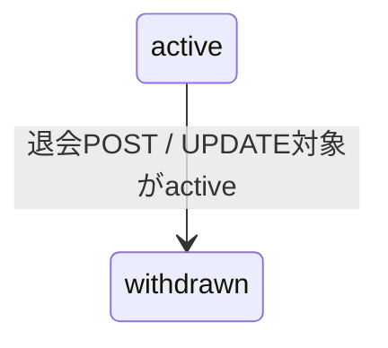
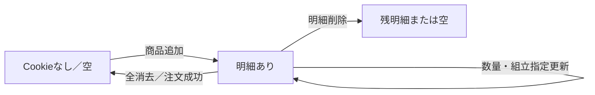
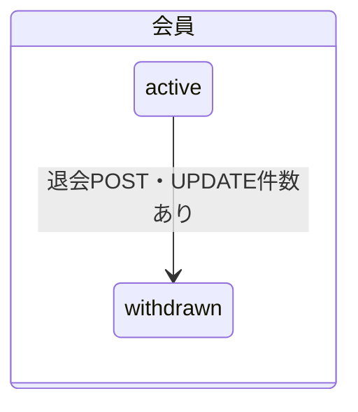

# OFFICE ORDER 状態遷移調査

## 1. 調査範囲と前提

本書は、リポジトリ内のDDL・seed SQL、Controller、Service、Repository、Mapper／SQL、Spring Batch設定、関連テストを調査した結果を記録する。DBや状態に近いデータについて、定義と実際の変更処理を分けて記載する。

READMEに記載された対象範囲は商品閲覧、会員登録、カート、注文、お問い合わせまでであり、受注後の業務処理と管理画面は別システムの責務である。注文状態がDBに定義されていることだけをもって、本リポジトリがその後続状態へ更新すると判断しない。[README.md:3-6](../../README.md#L3-L6)

SQL定義・seedを含むリポジトリ内のファイルを検索した範囲では、注文状態を変更するトリガー／関数の定義は見つからなかった。稼働中DBにリポジトリ外から設定されたトリガー、関数、別システムによる更新は未確認である。

## 2. 会員状態の遷移

### 定義と変更処理

| 項目 | 内容 |
|---|---|
| 状態を管理する場所 | `members.member_status`、`members.withdrawn_at`。 |
| 状態の種類 | DB制約上は`active`と`withdrawn`。利用停止等の別状態は確認できない。[members.sql:23](../../sql/schema/members.sql#L23) |
| 初期状態 | 会員登録INSERTは`member_status='active'`、`withdrawn_at=NULL`を設定する。[MemberMapper.xml:156-204](../../src/main/resources/mappers/MemberMapper.xml#L156-L204) |
| 変更条件 | `/mypage/withdraw`のPOSTから会員IDを受け取る。SQLは対象IDが一致し、現在の状態が`active`の場合だけ更新する。[MyPageController.java:421-426](../../src/main/java/jp/co/skig/officeorder/web/MyPageController.java#L421-L426) [MemberMapper.xml:441-449](../../src/main/resources/mappers/MemberMapper.xml#L441-L449) |
| 変更前・変更後 | 確認できた変更は`active → withdrawn`のみ。SQLは退会日時も設定する。DB制約により`withdrawn`の場合は`withdrawn_at`が必須。[members.sql:23-28](../../sql/schema/members.sql#L23-L28) |
| 状態変更を行う処理 | Controller → `MemberService.withdraw` → `MemberRepository.withdrawMember` → `MemberMapper.withdrawMember`。Repositoryは更新件数が1件以上ならtrueを返す。[MemberService.java:225-235](../../src/main/java/jp/co/skig/officeorder/service/member/MemberService.java#L225-L235) [MemberRepository.java:173-175](../../src/main/java/jp/co/skig/officeorder/repository/MemberRepository.java#L173-L175) [MemberMapper.java:141-145](../../src/main/java/jp/co/skig/officeorder/mapper/MemberMapper.java#L141-L145) |
| 関連処理 | 退会POST後、ControllerはServiceの戻り値によらずセッションを破棄して`/login`へ遷移する。[MyPageController.java:421-426](../../src/main/java/jp/co/skig/officeorder/web/MyPageController.java#L421-L426) ログイン認証と会員ID検索はいずれも`active`のみを対象とする。[MemberMapper.xml:107-127](../../src/main/resources/mappers/MemberMapper.xml#L107-L127) |
| エラー・制約 | 更新件数0件の場合、Serviceは警告ログを出しfalseを返すが、Controllerはその値で画面遷移を分けない。[MemberService.java:225-235](../../src/main/java/jp/co/skig/officeorder/service/member/MemberService.java#L225-L235) 通常の再退会POSTは`/mypage/**`のInterceptorで有効性確認され、退会済みならセッションを破棄して`/login?expired=true`へリダイレクトされる。[WebLoggingConfig.java:62-63](../../src/main/java/jp/co/skig/officeorder/config/WebLoggingConfig.java#L62-L63) [MemberActiveValidationInterceptor.java:50-71](../../src/main/java/jp/co/skig/officeorder/web/auth/MemberActiveValidationInterceptor.java#L50-L71) |
| 関連テスト | 認証情報あり／なしのテストはある。[MemberUserDetailsServiceTest.java:21-36](../../src/test/java/jp/co/skig/officeorder/service/member/MemberUserDetailsServiceTest.java#L21-L36) `MemberServiceTest`には退会UPDATE件数や退会遷移を直接検証するテストは確認できない。[MemberServiceTest.java](../../src/test/java/jp/co/skig/officeorder/service/member/MemberServiceTest.java) |
| 根拠ファイル・行番号 | 上記各項目を参照。 |

### 会員状態遷移図

この図はDB更新で確認できた遷移のみを示す。退会済み会員による通常の再退会POSTはControllerに到達する前にInterceptorで拒否される。別経路からServiceを呼び出してUPDATE件数が0になる場合は、Serviceがfalseを返すが、画面上の失敗表示は確認できない。[MemberMapper.xml:441-449](../../src/main/resources/mappers/MemberMapper.xml#L441-L449) [MemberActiveValidationInterceptor.java:62-71](../../src/main/java/jp/co/skig/officeorder/web/auth/MemberActiveValidationInterceptor.java#L62-L71) [MyPageController.java:421-426](../../src/main/java/jp/co/skig/officeorder/web/MyPageController.java#L421-L426)

退会POSTでは当該リクエストのセッションを破棄する。別の既存セッションを一斉に無効化する処理は確認できず、そのセッションは後に`/mypage/**`へアクセスした際にInterceptorの有効性確認を受ける。[MemberSessionService.java:91-103](../../src/main/java/jp/co/skig/officeorder/web/auth/MemberSessionService.java#L91-L103) [WebLoggingConfig.java:62-63](../../src/main/java/jp/co/skig/officeorder/config/WebLoggingConfig.java#L62-L63)

## 3. 注文状態の遷移

### 定義と変更処理

| 項目 | 内容 |
|---|---|
| 状態を管理する場所 | `orders.order_status`。状態履歴は`order_status_histories.status`。[orders.sql:1-6](../../sql/schema/orders.sql#L1-L6) [orders.sql:83-89](../../sql/schema/orders.sql#L83-L89) |
| 状態の種類 | DDLで`received`、`awaiting_payment`、`processing`、`completed`、`cancelled`を許可する。[orders.sql:5-6](../../sql/schema/orders.sql#L5-L6) |
| 初期状態 | DB DEFAULTと注文INSERTの双方で`received`。これは注文新規作成時の設定であり、後続状態への遷移ではない。[orders.sql:5-6](../../sql/schema/orders.sql#L5-L6) [OrderMapper.xml:124-166](../../src/main/resources/mappers/OrderMapper.xml#L124-L166) |
| 変更条件 | 注文作成後に状態を更新するController・Service処理は確認できない。 |
| 変更前・変更後 | 注文新規作成時に初期値`received`を設定する。`awaiting_payment`、`processing`、`completed`、`cancelled`への遷移は本アプリ内で確認できない。 |
| 状態変更を行う処理 | `OrderService`が`received`の初期履歴を作成し、Repository／Mapper XMLが`order_status_histories`へINSERTする。注文作成後の`orders` UPDATEおよび追加の履歴INSERTは、Controller、Service、Repository、Mapper XML、SQL、バッチ処理の検索範囲で見つからない。[OrderService.java:236-240](../../src/main/java/jp/co/skig/officeorder/service/order/OrderService.java#L236-L240) [OrderRepository.java:105-106](../../src/main/java/jp/co/skig/officeorder/repository/OrderRepository.java#L105-L106) [OrderMapper.xml:242-255](../../src/main/resources/mappers/OrderMapper.xml#L242-L255) |
| 関連処理 | 注文作成時に注文ヘッダ、明細、`received`の初期履歴を保存する。[OrderService.java:193-240](../../src/main/java/jp/co/skig/officeorder/service/order/OrderService.java#L193-L240) |
| エラー・制約 | DDLのCHECK制約は上記5状態以外を許可しない。後続状態更新処理が存在しないため、その更新時のアプリ側エラー処理は確認できない。[orders.sql:5-6](../../sql/schema/orders.sql#L5-L6) |
| 関連テスト | 空カート拒否、決済案内・メールコールバックのテストはあるが、注文状態の後続遷移を検証するテストは確認できない。[OrderServiceTest.java:77-120](../../src/test/java/jp/co/skig/officeorder/service/order/OrderServiceTest.java#L77-L120) |
| 根拠ファイル・行番号 | 上記各項目を参照。 |

### 注文状態についての調査結果

アプリ内で確認できたのは、注文作成時の初期値`received`の設定と、同値の履歴INSERTまでである。後続状態をつなぐ遷移図は作成しない。READMEは受注後の業務処理を別システムの責務としている。[README.md:3-6](../../README.md#L3-L6)

## 4. カートの状態変化

カートには専用の状態カラム／状態Enumは確認できない。以下は状態遷移ではなく、`office_order_cart` Cookieに保持する明細データの変化である。

| 項目 | 内容 |
|---|---|
| 状態を管理する場所 | Cookie内のバリアントID・数量・組立指定。空か明細ありかはロードした明細リストから判定する。[CartCookieStore.java:24-29](../../src/main/java/jp/co/skig/officeorder/repository/CartCookieStore.java#L24-L29) [CartCookieStore.java:44-84](../../src/main/java/jp/co/skig/officeorder/repository/CartCookieStore.java#L44-L84) |
| 状態の種類 | 専用の状態値はない。データとしてCookieなし／空、または1件以上の明細がある。 |
| 初期状態 | Cookieがない／空なら空の明細リストを返す。[CartCookieStore.java:44-64](../../src/main/java/jp/co/skig/officeorder/repository/CartCookieStore.java#L44-L64) |
| 変更条件 | 商品追加、数量・組立指定更新、明細削除、カート消去、注文成功時のCookie消去。各操作はControllerからCartServiceを呼ぶ。[CartController.java:122-135](../../src/main/java/jp/co/skig/officeorder/web/CartController.java#L122-L135) [CartController.java:159-168](../../src/main/java/jp/co/skig/officeorder/web/CartController.java#L159-L168) [CartController.java:187-192](../../src/main/java/jp/co/skig/officeorder/web/CartController.java#L187-L192) [CartController.java:228-233](../../src/main/java/jp/co/skig/officeorder/web/CartController.java#L228-L233) [CartController.java:378-405](../../src/main/java/jp/co/skig/officeorder/web/CartController.java#L378-L405) |
| 変更前・変更後 | Cookieなし／空→商品追加で明細あり、既存明細→数量・組立指定更新、明細削除で残明細または空、消去・注文成功で空。 |
| 状態変更を行う処理 | `CartController`→`CartService.addItem/updateItem/removeItem/clear`→`CartCookieStore.save/clear`。カートはDBの状態行としてではなくCookieに保存される。[CartService.java:224-327](../../src/main/java/jp/co/skig/officeorder/service/cart/CartService.java#L224-L327) [CartCookieStore.java:94-151](../../src/main/java/jp/co/skig/officeorder/repository/CartCookieStore.java#L94-L151) |
| 関連処理 | カート読込時に現在販売期間内の商品スナップショットと照合し、対象外の商品を画面明細から除く。[CartMapper.xml:21-41](../../src/main/resources/mappers/CartMapper.xml#L21-L41) |
| エラー・制約 | 数量1～99、最大100明細。追加／更新時に在庫0なら例外。Cookie読込でもID・数量を検証する。[CartService.java:232-250](../../src/main/java/jp/co/skig/officeorder/service/cart/CartService.java#L232-L250) [CartService.java:280-289](../../src/main/java/jp/co/skig/officeorder/service/cart/CartService.java#L280-L289) [CartCookieStore.java:70-82](../../src/main/java/jp/co/skig/officeorder/repository/CartCookieStore.java#L70-L82) |
| 関連テスト | 追加時の数量結合・組立指定正規化、存在しない明細更新、カート計算・正規化を確認するテストがある。[CartServiceTest.java:69-97](../../src/test/java/jp/co/skig/officeorder/service/cart/CartServiceTest.java#L69-L97) [CartServiceTest.java:99-145](../../src/test/java/jp/co/skig/officeorder/service/cart/CartServiceTest.java#L99-L145) |
| 根拠ファイル・行番号 | 上記各項目を参照。 |

カートの操作は状態遷移図ではなく、次のデータ変化として示す。

## 5. お問い合わせの状態管理

| 項目 | 内容 |
|---|---|
| 状態を管理する場所 | `inquiries`テーブル。ライフサイクル状態カラム（受付、対応中、完了等）は確認できない。[content.sql:18-42](../../sql/schema/content.sql#L18-L42) |
| 状態の種類 | `inquiry_type`は問い合わせ種別、`order_phase`は`before_order`／`after_order`の区分であり、対応状態ではない。[content.sql:27-29](../../sql/schema/content.sql#L27-L29) |
| 初期状態 | 問い合わせINSERTはフォーム内容・作成更新日時を保存するが、ライフサイクル状態値はない。[ContactMapper.xml:31-65](../../src/main/resources/mappers/ContactMapper.xml#L31-L65) |
| 変更条件 | 状態変更条件は確認できない。 |
| 変更前・変更後 | 問い合わせの状態遷移は未確認。 |
| 状態変更を行う処理 | `ContactService.submit`からRepository／MapperのINSERTを行う処理はあるが、状態更新処理は確認できない。[ContactService.java:74-77](../../src/main/java/jp/co/skig/officeorder/service/contact/ContactService.java#L74-L77) |
| 関連処理 | 送信時に問い合わせIDを取得し、受付ログを出力する。[ContactService.java:74-81](../../src/main/java/jp/co/skig/officeorder/service/contact/ContactService.java#L74-L81) |
| エラー・制約 | DBでは問い合わせ種別と注文前後区分をCHECK制約で限定する。対応状態の制約・失敗処理は未確認。[content.sql:27-29](../../sql/schema/content.sql#L27-L29) |
| 関連テスト | 入力正規化後の問い合わせ登録を検証するテストはあるが、状態遷移テストはない。[ContactServiceTest.java:54-72](../../src/test/java/jp/co/skig/officeorder/service/contact/ContactServiceTest.java#L54-L72) |
| 根拠ファイル・行番号 | 上記各項目を参照。 |

## 6. その他の状態管理

### お気に入り

| 項目 | 内容 |
|---|---|
| 状態を管理する場所 | 専用状態カラムではなく`member_favorites`行の有無。 |
| 状態の種類 | 行あり／行なしで判定するデータ状態。 |
| 初期状態 | 対象会員・商品に対応する行がなければ未登録。 |
| 変更条件 | Toggle時、行があれば削除、なければ件数上限を確認してINSERTする。[MemberService.java:336-354](../../src/main/java/jp/co/skig/officeorder/service/member/MemberService.java#L336-L354) |
| 変更前・変更後 | 行なし→行あり、行あり→行なし。これは専用状態カラムの遷移ではなく行の追加・削除。 |
| 状態変更を行う処理 | Service→Repository→Mapperの存在確認／INSERT／DELETE。[MemberMapper.xml:384-412](../../src/main/resources/mappers/MemberMapper.xml#L384-L412) |
| 関連処理 | 上限超過時は例外。INSERT競合時、行が既に存在する場合は処理を終了する。[MemberService.java:343-365](../../src/main/java/jp/co/skig/officeorder/service/member/MemberService.java#L343-L365) |
| エラー・制約 | 上限は`FAVORITES_LIMIT`。DBの会員・商品参照制約も適用される。[MemberService.java:343-347](../../src/main/java/jp/co/skig/officeorder/service/member/MemberService.java#L343-L347) [coupons.sql:35-44](../../sql/schema/coupons.sql#L35-L44) |
| 関連テスト | 既存行の削除、未登録行の追加を検証する。[MemberServiceTest.java:87-103](../../src/test/java/jp/co/skig/officeorder/service/member/MemberServiceTest.java#L87-L103) |
| 根拠ファイル・行番号 | 上記各項目を参照。 |

### クーポン利用実績

| 項目 | 内容 |
|---|---|
| 状態を管理する場所 | `member_coupon_usage.usage_count`、`last_used_at`。行は会員・クーポン単位。[coupons.sql:21-32](../../sql/schema/coupons.sql#L21-L32) |
| 状態の種類 | 利用回数の数値。`usage_count`の初期値は0。[coupons.sql:25-27](../../sql/schema/coupons.sql#L25-L27) |
| 初期状態 | 新規レコードのDDL DEFAULTは0。利用記録メソッドは`usage_count=1`を設定してINSERTする。[CouponServiceImpl.java:66-73](../../src/main/java/jp/co/skig/officeorder/service/coupon/CouponServiceImpl.java#L66-L73) |
| 変更条件 | `recordCouponUsage(memberId, couponId)`の呼出し。具体的な注文等からの呼出元は見つからない。[CouponService.java:14](../../src/main/java/jp/co/skig/officeorder/service/coupon/CouponService.java#L14) |
| 変更前・変更後 | `recordCouponUsage`によるINSERTは実装されている。既存行の加算／更新処理や、実運用で当メソッドが呼ばれる条件は未確認。 |
| 状態変更を行う処理 | `CouponServiceImpl.recordCouponUsage`→`CouponMapper.insertUsage`→`member_coupon_usage` INSERT。[CouponServiceImpl.java:66-73](../../src/main/java/jp/co/skig/officeorder/service/coupon/CouponServiceImpl.java#L66-L73) [CouponMapper.xml:24-37](../../src/main/resources/mappers/CouponMapper.xml#L24-L37) |
| 関連処理 | クーポン検証は現在の利用数を合計し、上限と比較する。[CouponServiceImpl.java:44-48](../../src/main/java/jp/co/skig/officeorder/service/coupon/CouponServiceImpl.java#L44-L48) |
| エラー・制約 | `usage_count >= 0`、会員・クーポン一組につきUNIQUE制約。[coupons.sql:25-29](../../sql/schema/coupons.sql#L25-L29) |
| 関連テスト | 呼出元や利用実績INSERTを確認するテストは見つからない。 |
| 根拠ファイル・行番号 | 上記各項目を参照。 |

### 公開・有効フラグ

| 項目 | 内容 |
|---|---|
| 状態を管理する場所 | お知らせ、クーポン、税率、色、商品検索用属性マスタ等に`is_active`列がある。例：お知らせ[content.sql:1-11](../../sql/schema/content.sql#L1-L11)、クーポン[coupons.sql:2-14](../../sql/schema/coupons.sql#L2-L14)、税率[batch.sql:1-10](../../sql/schema/batch.sql#L1-L10)、色[products.sql:1-12](../../sql/schema/products.sql#L1-L12)、属性マスタ[masters.sql:1-70](../../sql/schema/masters.sql#L1-L70)。 |
| 状態の種類 | BOOLEANのTRUE／FALSE。 |
| 初期状態 | 上記DDLの`is_active`はDEFAULT TRUE。 |
| 変更条件 | アプリ内でTRUE／FALSEを切り替える更新処理は確認できない。 |
| 変更前・変更後 | アプリ内の変更前後は未確認。 |
| 状態変更を行う処理 | 状態切替UPDATEは確認できない。参照時の有効判定は実装されている。例：AnnouncementMapperは有効期間と`is_active=TRUE`で絞る。[AnnouncementMapper.xml:21-29](../../src/main/resources/mappers/AnnouncementMapper.xml#L21-L29) |
| 関連処理 | クーポンは無効フラグなら検証を拒否する。[CouponServiceImpl.java:26-31](../../src/main/java/jp/co/skig/officeorder/service/coupon/CouponServiceImpl.java#L26-L31) |
| エラー・制約 | 値はBOOLEAN。フラグ更新のエラー・制約処理は未確認。 |
| 関連テスト | 有効フラグの切替を確認するテストは見つからない。 |
| 根拠ファイル・行番号 | 上記各項目を参照。 |

### レビュー公開状態

| 項目 | 内容 |
|---|---|
| 状態を管理する場所 | `product_review.published` BOOLEAN。[members.sql:59-68](../../sql/schema/members.sql#L59-L68) |
| 状態の種類 | TRUE／FALSE。 |
| 初期状態 | DDL DEFAULT TRUEであり、レビューINSERTもtrueを設定する。[members.sql:66](../../sql/schema/members.sql#L66) [ReviewMapper.xml:63-82](../../src/main/resources/mappers/ReviewMapper.xml#L63-L82) |
| 変更条件 | 既存レビューの評価・タイトル・本文を更新するSQLはあるが、`published`は更新しない。[ReviewMapper.xml:86-98](../../src/main/resources/mappers/ReviewMapper.xml#L86-L98) |
| 変更前・変更後 | 新規レビューのTRUE設定のみ確認。FALSEへの切替や公開状態変更は未確認。 |
| 状態変更を行う処理 | 新規INSERTは`published=true`。既存行の公開状態を変更する処理は確認できない。 |
| 関連処理 | レビュー表示・集計SQLは`published=true`に限定する。[ReviewMapper.xml:18-42](../../src/main/resources/mappers/ReviewMapper.xml#L18-L42) |
| エラー・制約 | 公開状態切替に関する制約・エラー処理は未確認。 |
| 関連テスト | `published`の状態変更を検証するテストは確認できない。 |
| 根拠ファイル・行番号 | 上記各項目を参照。 |

### 商品販売可否・在庫

| 項目 | 内容 |
|---|---|
| 状態を管理する場所 | 商品の販売期間は`products.sale_start_at`／`sale_end_at`、在庫は`product_variants.stock_quantity`。[products.sql:15-29](../../sql/schema/products.sql#L15-L29) [products.sql:47-67](../../sql/schema/products.sql#L47-L67) |
| 状態の種類 | 販売期間内／期間外は時刻による判定。在庫数は0以上の整数で、販売可否のENUMは確認できない。 |
| 初期状態 | 在庫数のDDL DEFAULTは0。商品には販売開始日時が必須で、終了日時はNULL可。[products.sql:25-27](../../sql/schema/products.sql#L25-L27) [products.sql:53](../../sql/schema/products.sql#L53) |
| 変更条件 | 商品販売期間を変更する更新処理、注文時に在庫を減算する処理は確認できない。 |
| 変更前・変更後 | 時刻が販売期間を通過するとSQLの条件上、検索対象が変わる。これは状態UPDATEではない。在庫数の変更経路は未確認。 |
| 状態変更を行う処理 | CartMapperは販売期間内の商品を取得する。[CartMapper.xml:21-41](../../src/main/resources/mappers/CartMapper.xml#L21-L41) OrderServiceは注文確定直前に在庫数・数量を再確認するが、減算しない。[OrderService.java:412-425](../../src/main/java/jp/co/skig/officeorder/service/order/OrderService.java#L412-L425) |
| 関連処理 | DDLは在庫数を非負に制限し、販売終了日時が開始日時より後であることを要求する。[products.sql:29](../../sql/schema/products.sql#L29) [products.sql:53](../../sql/schema/products.sql#L53) |
| エラー・制約 | 注文数量が在庫を超える、または在庫0の場合、Serviceは在庫不足例外を投げる。[OrderService.java:416-424](../../src/main/java/jp/co/skig/officeorder/service/order/OrderService.java#L416-L424) |
| 関連テスト | 商品販売期間・在庫の状態変更や注文時在庫減算を検証するテストは確認できない。 |
| 根拠ファイル・行番号 | 上記各項目を参照。 |

## 7. Spring Batchの実行状態

| 項目 | 内容 |
|---|---|
| 状態を管理する場所 | Spring Batchメタデータの`batch_job_execution.status`、`batch_step_execution.status`。[spring-batch-metadata.sql:8-17](../../sql/schema/spring-batch-metadata.sql#L8-L17) [spring-batch-metadata.sql:34-43](../../sql/schema/spring-batch-metadata.sql#L34-L43) |
| 状態の種類 | 本アプリのListenerが明示的に判定する値は`COMPLETED`と`STOPPED`。Spring Batchの状態値全体を本アプリで列挙・定義するコードは確認できない。[BatchJobExecutionLoggingListener.java:51-77](../../src/main/java/jp/co/skig/officeorder/service/batch/BatchJobExecutionLoggingListener.java#L51-L77) |
| 初期状態 | DBメタデータDDLには状態DEFAULTの指定がない。実行開始時の初期状態設定はSpring Batch側の処理であり、本アプリが直接設定するコードは確認できない。 |
| 変更条件 | アプリは`JobOperator.start`で開始を依頼し、停止時は実行IDの存在と実行中状態を確認して`JobOperator.stop`を呼ぶ。[BatchExecutionService.java:202-215](../../src/main/java/jp/co/skig/officeorder/service/batch/BatchExecutionService.java#L202-L215) [BatchExecutionService.java:140-160](../../src/main/java/jp/co/skig/officeorder/service/batch/BatchExecutionService.java#L140-L160) |
| 変更前・変更後 | 停止要求前に実行中であることを検査するが、要求後に`STOPPING`や`STOPPED`へ変化したことをアプリが確認する処理はない。実際の状態変更・保存はSpring Batchに委ねられる。 |
| 状態変更を行う処理 | アプリは開始・停止を依頼する。`setStatus`等で状態値を直接設定する処理は見つからない。Listenerは終了後の状態を参照してログを分岐するだけ。[BatchExecutionService.java:202-215](../../src/main/java/jp/co/skig/officeorder/service/batch/BatchExecutionService.java#L202-L215) [BatchJobExecutionLoggingListener.java:54-77](../../src/main/java/jp/co/skig/officeorder/service/batch/BatchJobExecutionLoggingListener.java#L54-L77) |
| 関連処理 | 起動時と毎時0分にジョブを起動する。[BatchScheduler.java:30-42](../../src/main/java/jp/co/skig/officeorder/service/batch/BatchScheduler.java#L30-L42) Listenerは`COMPLETED`、`STOPPED`、その他でログレベルを分ける。[BatchJobExecutionLoggingListener.java:54-77](../../src/main/java/jp/co/skig/officeorder/service/batch/BatchJobExecutionLoggingListener.java#L54-L77) |
| エラー・制約 | 実行IDなしは404、実行中でない／停止要求が受理されない場合は409、停止呼出し例外は500。[InternalBatchController.java:132-159](../../src/main/java/jp/co/skig/officeorder/web/InternalBatchController.java#L132-L159) |
| 関連テスト | 専用のBatch実行状態・停止完了テストは確認できない。 |
| 根拠ファイル・行番号 | 上記各項目を参照。 |

停止エンドポイントの202応答は**停止要求を受け付けた**ことを示し、停止完了を確認した応答ではない。[InternalBatchController.java:132-136](../../src/main/java/jp/co/skig/officeorder/web/InternalBatchController.java#L132-L136) 停止要求後に実行状態を再取得・確認する処理は未確認。`STOPPING`等への遷移をアプリ実装の確定遷移として図示しない。

## 8. 状態遷移一覧

| 対象 | 定義／データ上の値 | 実装で確認できた変更 | 遷移としての扱い |
|---|---|---|---|
| 会員 | `active`、`withdrawn` | 退会時に`active → withdrawn` | 状態遷移として確認済み。上記Mermaid図に記載。 |
| 注文 | `received`、`awaiting_payment`、`processing`、`completed`、`cancelled` | 注文作成時の初期値`received`と初期履歴INSERTのみ | `received`は初期設定。後続状態への遷移は未確認。 |
| カート | Cookie明細の有無・内容 | Cookie内の明細追加／更新／削除／消去 | 専用状態カラムがないためデータ変化として区別。 |
| お問い合わせ | 問い合わせ種別、注文前後区分 | 問い合わせレコードINSERT | ライフサイクル状態カラム・遷移は未確認。 |
| お気に入り | `member_favorites`行の有無 | 行のINSERT／DELETE | 専用状態カラムがないためデータ変化として区別。 |
| クーポン利用実績 | `usage_count`等 | 利用記録メソッドのINSERT | メソッドはあるが、呼出元・利用時の変更条件は未確認。 |
| 公開・有効フラグ | `is_active` BOOLEAN | アプリ内切替処理なし | TRUE／FALSEの定義・参照はあるが遷移未確認。 |
| レビュー公開 | `published` BOOLEAN | 新規INSERT時にTRUE | FALSEへの切替は未確認。 |
| 商品販売期間・在庫 | 販売日時・在庫数量 | 時刻条件で表示判定、注文時在庫再確認 | 状態UPDATE・在庫減算は未確認。 |
| Spring Batch | Spring Batchメタデータのstatus | アプリから開始／停止要求 | 実状態管理はSpring Batch側。停止完了確認は未確認。 |

以下はアプリコードで確認できた**状態遷移**のみを示す。注文の後続状態やSpring Batchの停止要求後の状態は図示しない。

カート、お気に入り、ランキング・おすすめの再集計は専用状態の遷移ではなく、データの追加・更新・削除として扱う。注文の`received`は初期値の設定であって、状態遷移図の矢印には含めない。

## 9. 未確認事項・別システムの責務

- 稼働中DBにリポジトリ外から追加された注文状態更新トリガー／関数、外部バッチ、別システムによる更新の有無は未確認。リポジトリ内のSQLファイルには該当する定義が見つからなかった。
- 注文の`awaiting_payment`、`processing`、`completed`、`cancelled`はDB制約に定義されるが、本アプリ内の更新SQL・Service処理は確認できない。READMEでは受注後の業務処理・管理画面を別システムの責務としている。[README.md:3-6](../../README.md#L3-L6)
- Spring Batchの全状態値、状態遷移の内部タイミング、停止要求後に実際に停止したかは未確認。アプリから確認できるのは開始／停止要求、状態参照、終了状態に応じたログ処理まで。
- お問い合わせの対応中・完了などの状態、管理画面や返信後の状態変更は未確認。DBにはライフサイクル状態カラムを確認できない。
- 会員の`inactive`、利用停止など`active`／`withdrawn`以外の状態は未確認。
- 退会処理のUPDATE件数0件を直接検証するテスト、退会成功・失敗を画面で区別する処理は確認できない。通常の退会済み会員による再POSTはInterceptorが先に拒否する。
- クーポン利用実績INSERTメソッドの具体的な呼出元と利用時の更新条件は未確認。
- `is_active`やレビュー`published`を切り替えるアプリ内更新処理、商品在庫の減算処理は確認できない。
